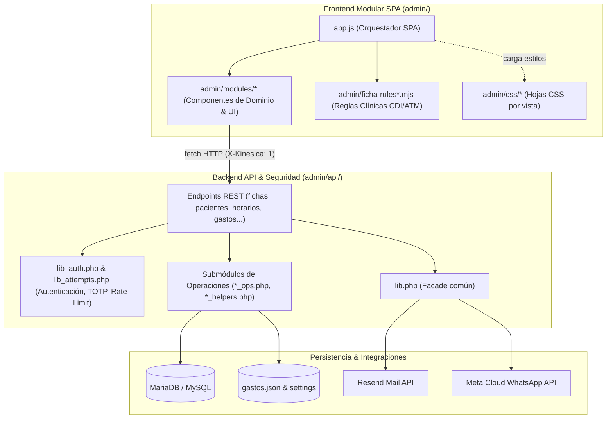

# Arquitectura Modular y Seguridad del Módulo Admin

Este documento describe la arquitectura técnica, la descomposición modular, los patrones de diseño y los mecanismos de seguridad implementados en el módulo de gestión clínica y administrativa de Kinésica (`/admin`).

---

## 1. Regla Arquitectónica Fundamental

> [!IMPORTANT]
> **Límite Estricto de 250 Líneas de Código:**
> Ningún archivo de código (`.js`, `.mjs`, `.php`) dentro del directorio `admin/` supera las **250 líneas**.  
> Esta restricción arquitectónica garantiza:
> - **Alta cohesión y principio de responsabilidad única (SRP)**: Cada módulo resuelve exactamente una tarea bien acotada.
> - **Máxima legibilidad y mantenibilidad**: Los componentes son rápidos de auditar, testear y refactorizar.
> - **Prevención de sobrecarga de contexto**: Los modelos de lenguaje y desarrolladores pueden cargar y razonar sobre módulos individuales sin consumir ventanas de contexto masivas.

---

## 2. Visión General de la Arquitectura

El sistema está construido como una **Single Page Application (SPA) modular nativa (ESM)** en el frontend y una **API REST desacoplada en PHP** en el backend, respaldada por MariaDB/MySQL.



---

## 3. Frontend: Desglose Modular (`admin/modules/`)

Todos los módulos utilizan exportaciones e importaciones estándar de ES6 (`import`/`export`).

### 3.1. Shell de la Aplicación y Navegación
- **`admin/app.js`**: Orquestador principal. Inicializa el ciclo de vida, expone bindings globales y coordina las pestañas.
- **`admin/modules/app-init.js`**: Rutina de arranque, detección de credenciales en memoria, verificación de sesión y carga diferida.
- **`admin/modules/app-tabs.js`**: Conmutación de vistas de la SPA (`#tab-form`, `#tab-library`, `#tab-compare`, `#tab-pacientes`, `#tab-horarios`, etc.).
- **`admin/modules/router.js`**: Sincronización del estado de URL con los hashes de vista.
- **`admin/modules/api.js`**: Cliente HTTP wrapper que inyecta automáticamente cabeceras de seguridad (`X-Kinesica: 1`), maneja errores y redirecciona ante sesiones expiradas (`401`).
- **`admin/modules/dom.js`**: Primitivas seguras para creación de elementos (`node`), sanitización contra XSS (`escapeHtml`) y utilidades como `debounce`.
- **`admin/modules/dom-dialogs.js`**: Modales de confirmación accesibles (`showConfirm`, `showPrompt`).

### 3.2. Formulario Clínico ATM (`admin/modules/form*.js`)
El formulario clínico de disfunción temporomandibular se estructura en subcomponentes especializados:
- **`form.js`**: Fachada orquestadora del formulario que unifica la API pública para el resto de la aplicación.
- **`form-nav.js`**: Controlador de navegación entre pasos (0 a 5), validación previa a avanzar y foco automático en campos obligatorios no completados.
- **`form-patient.js`**: Gestión de la filiación del paciente, selector de profesionales asignados (visible para admins), cálculo dinámico de edad y toggle de DNI.
- **`form-eva.js`**: Controlador reactivo de la escala EVA de dolor (0-10) con degradé semántico visual, sincronización de hábitos y botones de selección única (`data-single`).
- **`form-photos.js`**: Manejador del estado de fotos clínicas adjuntas, compresión concurrentemente limitada (máximo 10 imágenes) y subida controlada.
- **`form-photos-ui.js`**: Renderizado de la cuadrícula de miniaturas de fotos, acciones de borrado y contadores visuales.
- **`form-reader.js`**: Serialización bidireccional entre los inputs del DOM y el objeto JSON canónico de la ficha clínica.
- **`form-submit.js`**: Validación final de reglas clínicas y envío asíncrono al backend.
- **`form-image.js`**: Compresión client-side en canvas (`image/webp` / `image/jpeg`) a un máximo de 1920px y remoción de metadatos EXIF sensibles.
- **`form-restrictions.js`**: Reglas condicionales en tiempo real que habilitan o deshabilitan inputs según respuestas previas.

### 3.3. Reglas Clínicas de Dominio (`admin/ficha-rules*.mjs`)
Motor de lógica clínica agnóstico del DOM, compartido y verificado por la suite de pruebas automatizadas:
- **`ficha-rules.mjs`**: Re-exportador canónico y funciones de cálculo clínico (apertura bucal, ruidos articulares, dolor muscular).
- **`ficha-rules-validate.mjs`**: Validador estricto de estructura, coherencia de campos y criterios diagnósticos de investigación (CDI-TTM).
- **`ficha-rules-patient.mjs`**: Lógica de normalización de datos de filiación, nombres, DNI y claves de paciente.
- **`ficha-rules-defaults.mjs`**: Generador de valores por defecto e inicialización de esquemas clínicos.

### 3.4. Comparativa Clínica y Evolución (`admin/ficha-compare*.mjs` y `compare*.js`)
- **`ficha-compare.mjs`**: Algoritmo matemático de cálculo de diferencias entre sesiones (Sesión $A$ vs. Sesión $B$), delta de EVA, apertura bucal y variación de síntomas.
- **`ficha-compare-diff.mjs`**: Motor granular de diferencias campo a campo para la vista "Lo que cambió".
- **`compare.js`**: Controlador del panel de comparación y selección de sesiones históricas.
- **`compare-tabs.js`**: Navegación entre las pestañas "Resumen de KPIs", "Lo que cambió" y "Comparativa completa".
- **`compare-render.js`**: Renderizado de tablas y badges de evolución (mejoría, empeoramiento, sin cambios).

### 3.5. Biblioteca de Historias Clínicas (`admin/modules/library*.js`)
- **`library.js`**: Controlador principal de listado, filtros por fecha, profesional o patología.
- **`library-rows.js`**: Generación de filas para la vista cronológica estándar.
- **`library-session-row.js`**: Renderizado de filas anidadas en la vista agrupada por paciente.
- **`library-toolbar.js`**: Barra de herramientas con buscador en vivo, selector de vista y paginación.
- **`library-render.js`**: Renderizado mediante `DocumentFragment` para prevenir el *layout thrashing*.
- **`library-io.js`**: Exportación e importación segura de fichas en formato JSON con validación de esquema.
- **`library-pager.js`**: Algoritmo de paginación numérica dinámica.

### 3.6. Directorio de Pacientes (`admin/modules/pacientes*.js`)
- **`pacientes.js`**: Vista unificada de pacientes, consolidación histórica por DNI/teléfono.
- **`pacientes-format.js`**: Formateadores de nombres propios, teléfonos y fechas.
- **`pacientes-modal.js`**: Diálogo modal con la historia médica consolidada y accesos directos a nueva sesión o impresión.
- **`phone-search.js`**: Motor de búsqueda tolerante con normalización telefónica internacional (E.164).

### 3.7. Agenda y Horarios (`admin/modules/horarios*.js`)
- **`horarios.js`**: Orquestador de la vista de agenda y horarios de atención.
- **`horarios-editor.js`**: Interfaz de edición de franjas horarias por profesional (Norberto / María).
- **`horarios-validator.js`**: Verificación estricta en tiempo real de la restricción de **1 sola camilla física** (previene solapamientos).
- **`horarios-timeline.js`**: Visualización gráfica de la semana laboral y ocupación de camilla.

### 3.8. Configuración y Automatización Clara (`admin/modules/config*.js`)
- **`configuracion.js`**: Fachada del panel de ajustes de consultorio y mensajes automáticos.
- **`config-toggles.js`**: Interruptores de ausencias, vacaciones y recordatorios.
- **`config-options.js`**: Gestión de opciones dinámicas de menús y avisos.
- **`config-save.js`**: Persistencia asíncrona hacia el backend.
- **`config-defaults.js`**: Configuración de respaldo por defecto.
- **`config-views.js`**: Renderizado de pestañas de configuración.
- **`chat-simulator.js`**: Simulador interactivo en tiempo real del bot de WhatsApp Clara.
- **`menu-texts.js`**: Catálogo de textos informativos de consultorio, direcciones e indicaciones.

### 3.9. Profesionales, Gastos y Administración (`admin/modules/admin*.js`)
- **`admin-panel.js`**: Entrada del panel de administración del consultorio.
- **`admin-profesionales.js`**: Alta, baja, edición de roles (`admin`/`professional`) y reenvío de invitaciones a profesionales.
- **`admin-gastos.js`**: Listado de costos operativos con filtrado por categoría y período.
- **`admin-gastos-modal.js`**: Formulario modal para registrar o editar gastos.
- **`admin-gastos-rates.js`**: Conversión y normalización multimoneda (EUR, USD, ARS).
- **`honorarios.js`**: Editor de honorarios de consulta y medios de pago.

### 3.10. Autenticación y Seguridad Frontend (`admin/modules/auth*.js`)
- **`auth.js`**: Controlador principal del gate de acceso y verificación 2FA.
- **`auth-email-code.js`**: Flujo alternativo de inicio de sesión mediante código de 6 dígitos enviado por correo.
- **`auth-recovery.js`**: Solicitud de restablecimiento de contraseña y cambio seguro.
- **`auth-utils.js`**: Toggles de visibilidad de contraseña accesibles e indicadores de fortaleza.

### 3.11. Impresión y Exportación Homologada (`admin/modules/print*.js`)
- **`print.js`**: Orquestador de impresión institucional en formato A4.
- **`print-sections.js`**: Ensamblado de secciones clínicas con protección contra cortes de página (`break-inside: avoid`).
- **`print-parts.js`**: Carga asíncrona segura de sellos y firmas digitales (`img.decode()`).

---

## 4. Backend PHP: Arquitectura y Descomposición (`admin/api/`)

Todos los archivos de backend respetan el límite de 250 líneas y dividen la lógica en submódulos especializados.

```mermaid
flowchart LR
    subgraph CoreLibs ["Librerías Core de Soporte"]
        Lib["lib.php (Facade)"]
        LibDB["lib_db.php (PDO & JSON)"]
        LibAuth["lib_auth.php (Session & TOTP)"]
        LibAttempts["lib_attempts.php (Rate Limiting)"]
        LibCodes["lib_codes.php (Tokens Temporales)"]
        LibMail["lib_mail.php (Resend Mail)"]
        LibWA["lib_whatsapp.php (WhatsApp API)"]
        LibWATpl["lib_whatsapp_template.php (Templates)"]
    end

    subgraph EndpointsAPI ["Endpoints REST (Controladores)"]
        Fichas["fichas.php"] --> FichasOps["fichas_ops.php"]
        Pacientes["pacientes.php"] --> PacientesOps["pacientes_ops.php"]
        Pacientes --> PacientesHelpers["pacientes_helpers.php"]
        Horarios["horarios.php"] --> HorariosVal["horarios_validator.php"]
        Horarios --> HorariosSum["horarios_summary.php"]
        Horarios --> SettingsStore["kinesica_settings_storage.php"]
        Profesionales["profesionales.php"] --> ProfSync["profesionales_sync.php"]
        Profesionales --> ProfInvite["profesionales_invite.php"]
        Gastos["gastos.php"] --> GastosIO["gastos_io.php"]
        Interacciones["interacciones.php"] --> InteraccionesSeed["interacciones_seed.php"]
    end

    EndpointsAPI --> CoreLibs
```



### 4.1. Núcleo Común y Seguridad (`lib*.php`)
- **`lib.php`**: Fachada que expone y re-exporta funciones fundamentales para mantener total retrocompatibilidad con los tests y llamadas existentes.
- **`lib_db.php`**: Inicialización de PDO, manejo de transacciones, envío estandarizado de respuestas JSON (`json_out`, `json_error`) y cabeceras de seguridad.
- **`lib_auth.php`**: Autenticación mediante cookies de sesión estrictas (`SameSite=Lax`, `HttpOnly`, `Secure`), resolución de roles y motor TOTP nativo RFC 6238 con tolerancia $\pm 1$ paso.
- **`lib_attempts.php`**: Control de fuerza bruta contra login y reseteo de claves (bloqueo automático de 30 minutos al 5° fallo).
- **`lib_codes.php`**: Almacenamiento seguro y verificación de códigos OTP de 6 dígitos de un solo uso.
- **`lib_mail.php`**: Envío de correos transaccionales a través de la API HTTP de Resend con soporte multipart y fallback seguro.
- **`lib_whatsapp.php`**: Integración con Meta WhatsApp Cloud API y webhook de contingencia en n8n.
- **`lib_whatsapp_template.php`**: Generación de plantillas aprobadas (`alerta_profesional_kinesica`) y serialización de parámetros.

### 4.2. Endpoints y Submódulos de Dominio
- **Fichas Clínicas**:
  - `fichas.php`: Validación de sesión, autorización por rol/propietario, enrutamiento HTTP (GET/POST/DELETE).
  - `fichas_ops.php`: Validaciones clínicas de ATM, criterios CDI, persistencia de fotos adjuntas y control de herencia entre sesiones.
- **Pacientes**:
  - `pacientes.php`: Endpoint del directorio unificado de pacientes y lista de espera.
  - `pacientes_ops.php`: Operaciones de inserción, actualización, deduplicación y consolidación de historias.
  - `pacientes_helpers.php`: Normalización de teléfonos E.164, extracción de apellidos y formateo de nombres.
- **Agenda y Horarios**:
  - `horarios.php`: Endpoint de persistencia de días y turnos de atención.
  - `horarios_validator.php`: Validación matemática de intervalos horarios y garantía de **1 sola camilla física**.
  - `horarios_summary.php`: Generación de resúmenes textuales de horarios para el prompt del sistema de Clara.
  - `kinesica_settings_storage.php`: Guardado atómico en base de datos y archivos de configuración con bloqueo exclusivo (`LOCK_EX`).
- **Profesionales**:
  - `profesionales.php`: CRUD de cuentas profesionales y asignación de permisos.
  - `profesionales_sync.php`: Sincronización automática de profesionales en los ajustes de Clara y la web.
  - `profesionales_invite.php`: Creación de tokens de activación y envío de invitaciones por correo (48 hs).
- **Gastos Operativos**:
  - `gastos.php`: Endpoint de cálculo y reporte contable de costos de infraestructura.
  - `gastos_io.php`: Lectura, serialización atómica y normalización multimoneda (EUR/USD/ARS) sobre `gastos.json`.
- **Interacciones WhatsApp**:
  - `interacciones.php`: Endpoint de registro y visualización de conversaciones de pacientes.
  - `interacciones_seed.php`: Inicialización de conversaciones de prueba y límite estricto de historial (1000 items máximo).

---

## 5. Medidas de Seguridad y Robustez

| Vector / Mecanismo | Nivel de Protección | Implementación Técnica |
| :--- | :---: | :--- |
| **CSRF (Cross-Site Request Forgery)** | **Blindado** | Obligatoriedad de la cabecera `X-Kinesica: 1` en todas las peticiones `fetch`. Las peticiones cross-site no pueden enviar cabeceras personalizadas sin preflight CORS. |
| **XSS (Cross-Site Scripting)** | **Blindado** | Sanitización obligatoria en `dom.js` con `escapeHtml()`. Asignación de cadenas dinámicas exclusivamente mediante `textContent` o `node()`. |
| **IDOR / Control de Acceso** | **Blindado** | Verificación en cada request con `require_auth()` consultando el rol en vivo en la base de datos. Solo administradores o el creador de una ficha pueden modificarla o borrarla. |
| **Inyección SQL** | **Blindado** | 100% de consultas parametrizadas con sentencias preparadas de PDO (`$pdo->prepare(...)`). |
| **Ataques de Fuerza Bruta** | **Blindado** | Tablas `login_attempts` y `login_code_attempts`. Rate limiting con bloqueo temporal progresivo ante fallos reiterados (`HTTP 429`). |
| **Autenticación en Dos Pasos (2FA)** | **Blindado** | Implementación nativa TOTP RFC 6238 en `lib_auth.php`. Enrolamiento protegido por contraseña previa. |
| **Cookies de Sesión Seguras** | **Blindado** | `SameSite = Lax`, `HttpOnly = true`, `Secure = true`, `path = /admin/`. Regeneración del Session ID con `session_regenerate_id(true)` en cada login. |
| **Filtrado de Archivos Sensibles** | **Blindado** | Reglas estrictas en `.htaccess` denegando el acceso HTTP a `*.php` internos de configuración, `.sql`, `.bak` y `.log`. |

---

## 6. Procedimiento de Verificación y Testing

Para garantizar que el código se mantiene conforme a las reglas arquitectónicas y funcionales, ejecutar:

```bash
# 1. Linting estricto de JavaScript
npm run admin:lint

# 2. Batería de pruebas unitarias y de integración de admin
npm run admin:test

# 3. Verificación integral de todo el proyecto Kinésica
npm run verify
```

Para auditar en cualquier momento que ningún archivo supere las 250 líneas:
```bash
find admin -type f \( -name "*.js" -o -name "*.mjs" -o -name "*.php" \) -exec wc -l {} + | awk '$1 > 250 && $2 != "total"'
```
*(Debe retornar 0 resultados).*
