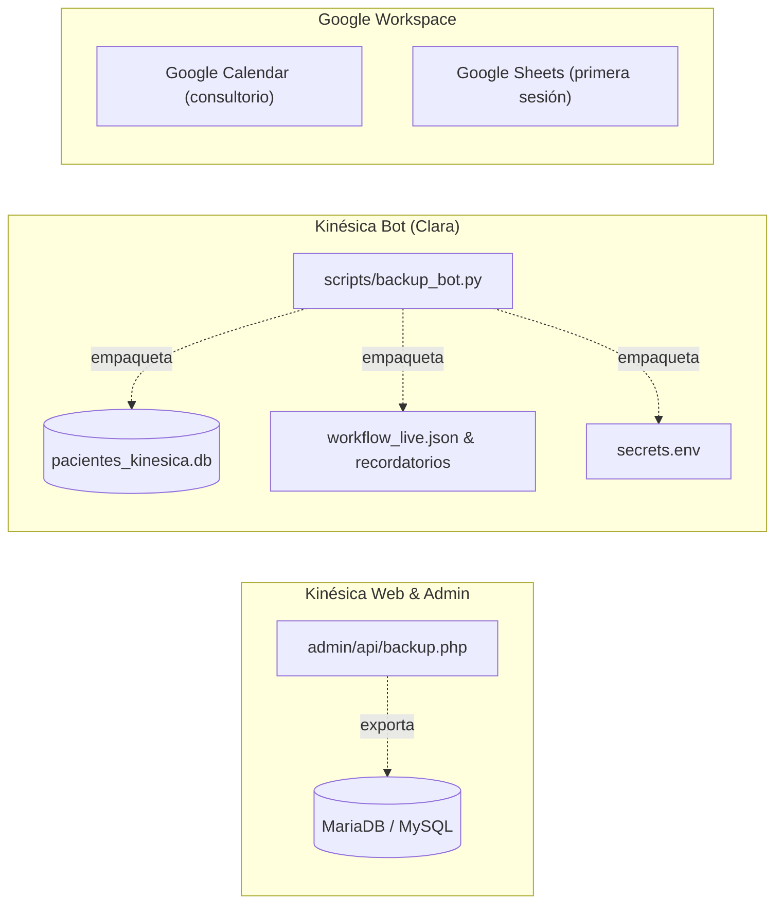

# 💾 Manual de Copias de Seguridad y Recuperación ante Desastres
### Kinésica Web (Hostinger) y Kinésica Bot (Clara / n8n)

> **Audiencia:** Administradores del Sistema y Profesionales Responsables.  
> **Última actualización:** Noviembre 2026.  
> **Frecuencia recomendada:** Semanal (rotación de 8 semanas, costo $0).  

---

## 📌 1. Visión General de la Infraestructura de Datos

El sistema Kinésica opera con dos núcleos de información desacoplados pero sincronizados:



| Componente | ¿Dónde vive? | ¿Qué información contiene? |
| :--- | :--- | :--- |
| **Kinésica MariaDB** | Servidor Web (Hostinger) | Pacientes, Fichas Clínicas (evaluaciones posturales, ATM, antecedentes), Usuarios, Lista de Espera, Eventos de auditoría. |
| **Clara SQLite** | Servidor Bot (VPS Hostinger) | Historial local de primeras sesiones agendadas (`pacientes_kinesica.db`). |
| **Clara Configuración** | Servidor Bot (VPS Hostinger) | Credenciales y claves de APIs (`secrets.env`) y workflows activos de n8n. |
| **Google Calendar & Sheets** | Nube de Google | Calendario oficial de turnos y planilla espejo de primeras sesiones. |

---

## 🏛️ 2. Kinésica Web: Copias de Seguridad

### A. Descarga Manual Inmediata (Panel Admin)
Podés generar y descargar un volcado SQL completo en cualquier momento:
1. Ingresá a `/admin` con tu usuario administrador.
2. En la solapa **Pacientes**, hacé clic en el botón superior **"Exportar Backup SQL"** (o en la tarjeta de Backups en la vista **Administración**).
3. Tu navegador descargará inmediatamente un archivo `kinesica-backup-YYYY-MM-DD.sql`.

### B. Programación Automática Semanal (Cron Job en Hostinger)
Para que el servidor genere una copia automáticamente cada semana:
1. Ingresá al panel de control **Hostinger hPanel**.
2. Navegá a **Avanzado → Tareas Cron (Cron Jobs)**.
3. Creá una nueva tarea:
   * **Tipo:** Común o Avanzado.
   * **Horario:** Semanal — Domingos a las 03:00 AM (`0 3 * * 0`).
   * **Comando:**
     ```bash
     php /home/uXXXXXXX/domains/kinesica.com.ar/public_html/admin/api/backup.php
     ```
     *(Reemplazá `uXXXXXXX` por el identificador de usuario de tu hosting, visible en el panel principal).*
4. **Política de retención:** El script almacena los backups en la carpeta privada `/backups/atm/` con permisos `0600` y conserva automáticamente las últimas **8 copias semanales** (2 meses), eliminando las más antiguas sin consumir espacio extra.

---

## 🤖 3. Kinésica Bot (Clara): Copias de Seguridad

El bot cuenta con un script dedicado en Python (`scripts/backup_bot.py`) que realiza una copia en caliente consistente de la base SQLite sin bloquear el bot, junto con los flujos y claves.

### A. Ejecución Manual y Comprobación
Desde la terminal en el servidor o entorno local:
```bash
# 1. Generar backup semanal
python3 scripts/backup_bot.py

# 2. Verificar integridad del archivo generado
python3 scripts/backup_bot.py --verify

# 3. Listar copias existentes en disco
python3 scripts/backup_bot.py --list
```

### B. Programación Automática Semanal (Cron Job en el VPS)
1. Conectate por SSH a la máquina donde corre n8n.
2. Abrí la configuración del cron:
   ```bash
   crontab -e
   ```
3. Agregá la siguiente línea al final del archivo (ejecuta todos los domingos a las 04:00 AM):
   ```bash
   0 4 * * 0 cd /ruta/a/kinesica-bot && python3 scripts/backup_bot.py >> /var/log/clara_backup.log 2>&1
   ```
4. El archivo generado se guardará en `kinesica-bot/backups/clara-backup-YYYY-MM-DD.tar.gz` (pesa aprox. 136 KB) con permisos restringidos `0600` e ignorado por Git.

---

## 🚨 4. Protocolo de Recuperación ante Desastres (Disaster Recovery)

Si algo falla, se borran registros por error o un servidor sufre una caída imprevista, seguí estos pasos según el caso:

### Escenario A: Falla la base de datos de Kinésica (Web/Admin)
* **Tiempo estimado:** 2 a 3 minutos.
* **Pasos:**
  1. Ingresá a **phpMyAdmin** desde el panel de Hostinger.
  2. Seleccioná la base de datos de Kinésica en la barra izquierda.
  3. Hacé clic en la pestaña superior **"Importar"**.
  4. Hacé clic en **"Seleccionar archivo"** y elegí la copia `kinesica-YYYY-MM-DD.sql` más reciente.
  5. Presioná **"Continuar"** al final de la página.
  6. **Resultado:** Todas las tablas y sus registros quedarán restaurados al instante.

### Escenario B: Falla o reinicio del VPS del Bot (n8n / Clara)
* **Tiempo estimado:** 3 a 5 minutos.
* **Pasos:**
  1. Ingresá por SSH al servidor del bot y navegá al directorio de backups:
     ```bash
     cd kinesica-bot/backups
     ```
  2. Descomprimí el backup deseado sobre la raíz del bot:
     ```bash
     tar -xzvf clara-backup-YYYY-MM-DD.tar.gz -C ../
     ```
  3. Si la instancia de n8n perdió los flujos activos, redesplegalos ejecutando:
     ```bash
     python3 deploy.py
     ```
  4. **Resultado:** Clara retoma la atención en WhatsApp con sus claves, base de datos y flujos sincronizados.

### Escenario C: Borrado accidental en Google Calendar o Sheets
* **Google Sheets:** Abrí la planilla, hacé clic en **Archivo → Historial de versiones → Ver historial de versiones** y restaurá cualquier versión anterior con un clic.
* **Google Calendar:** Si se borró un turno por error, hacé clic en la rueda de configuración (⚙️) → **Papelera**. Los eventos borrados permanecen disponibles para restaurar durante 30 días.
