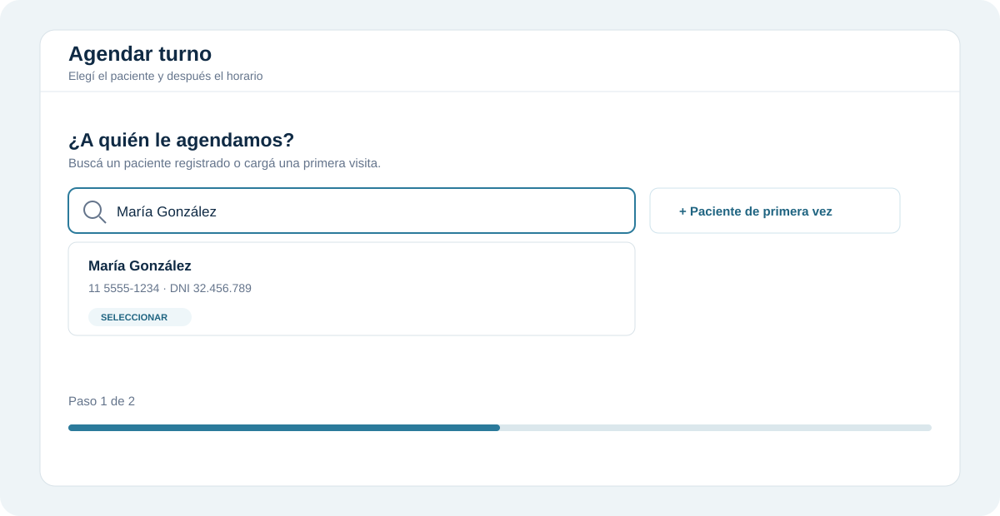
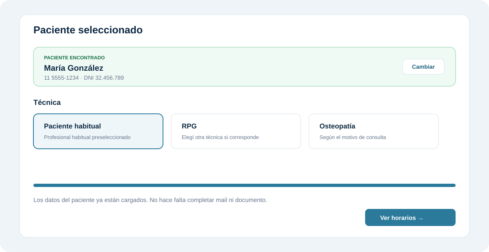
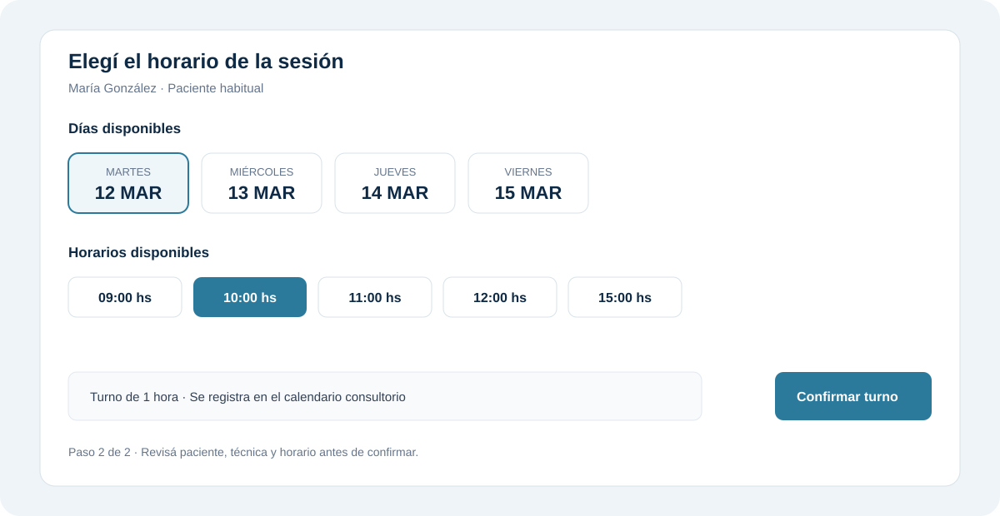
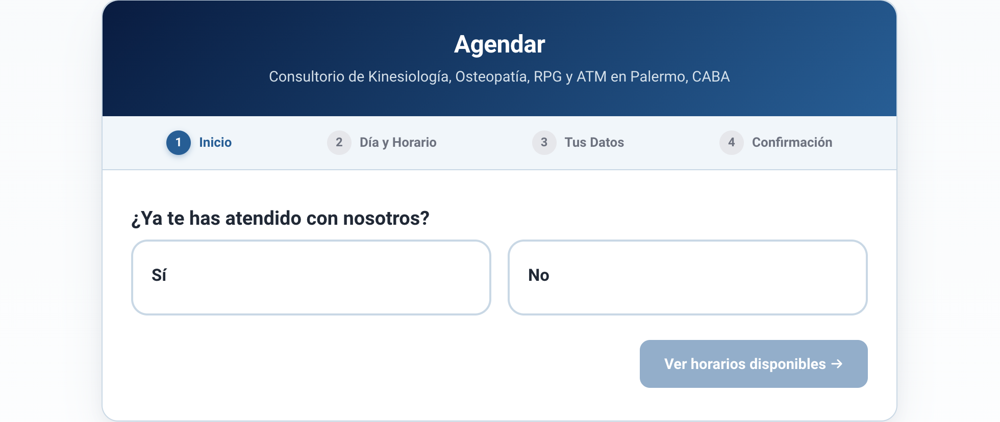
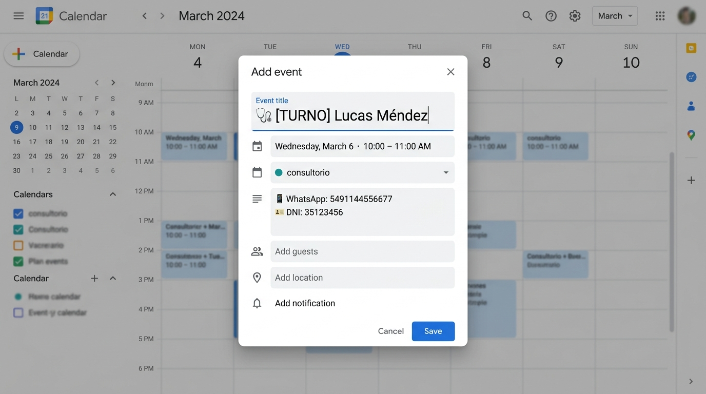
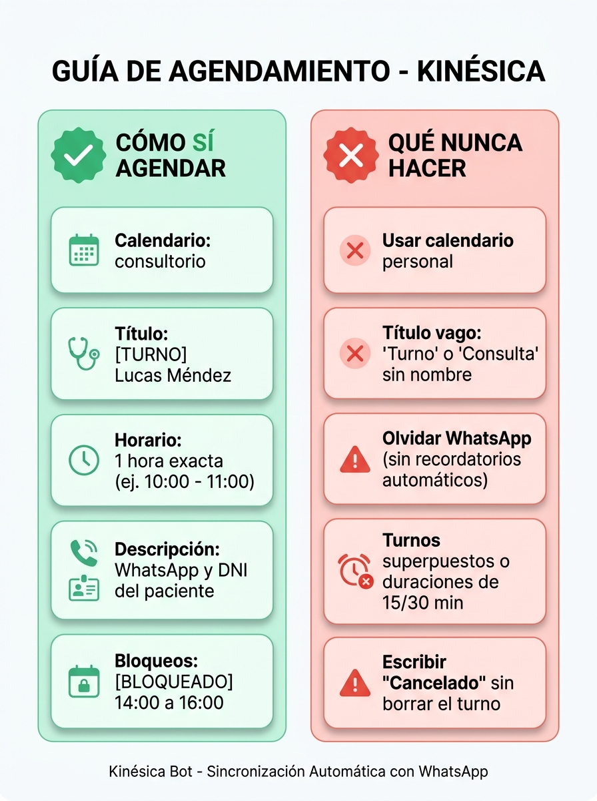

# Cómo agendar turnos correctamente

Guía breve para que los turnos queden bien en el calendario **consultorio**, con recordatorios y datos de contacto legibles por el sistema.

Podés agendar de tres formas:

1. **Desde Admin** — recomendado para agendar desde el consultorio y reutilizar el directorio de pacientes.
2. **Función Agendar del sitio** (`kinesica.com.ar/agendar.html`) — completa título y descripción sola.
3. **Google Calendar a mano** — seguí el formato de abajo.

---

## 1. Agendar desde Admin

Entrá a `/admin` → **Consultorio → Agendar Turnos** y elegí **Abrir turnera profesional**. El flujo tiene dos pasos: seleccionar el paciente y elegir un horario.

### Paciente ya registrado

1. En **¿A quién le agendamos?**, buscá por nombre, teléfono o DNI.
2. Elegí el resultado correcto de la lista.
3. Verificá el nombre y el teléfono que aparecen en la tarjeta verde **Paciente encontrado**.

<p align="center">
  
  <br>
  <em>Figura 1: búsqueda de un paciente existente desde la turnera de Admin.</em>
</p>

Cuando el paciente ya fue encontrado, **alcanza con seleccionarlo**: no hace falta completar mail, documento ni teléfono nuevamente. Los datos disponibles del directorio se reutilizan automáticamente.

Después elegí la técnica y, si corresponde, el profesional. Para pacientes habituales con profesional habitual configurado, Admin lo preselecciona.

<p align="center">
  
  <br>
  <em>Figura 2: paciente confirmado; solo resta elegir la técnica y continuar.</em>
</p>

### Paciente de primera vez

Si no aparece en la búsqueda, usá **+ Paciente de primera vez**. En ese caso completá los datos disponibles del paciente: **el nombre y el WhatsApp son los únicos indispensables**. El documento (DNI o Pasaporte) y el correo electrónico son **completamente opcionales** (pueden quedar vacíos sin trabar el agendamiento).

### Elegir y confirmar el horario

1. Tocá **Ver horarios disponibles** o **Confirmar turno**, según el paso mostrado.
2. Seleccioná un día y un horario libre.
3. Revisá el resumen y confirmá.

<p align="center">
  
  <br>
  <em>Figura 3: selección del horario disponible para el paciente.</em>
</p>

El turno queda registrado en el calendario **consultorio**. Si el paciente tiene mail cargado, el sistema le envía la confirmación oficial; si no tiene mail, la reserva se genera y confirma con la misma validez.

> **Importante:** antes de confirmar, verificá que el paciente seleccionado sea el correcto y que la técnica/profesional coincidan con lo solicitado.

---

## 2. Función Agendar (sitio web)

En `kinesica.com.ar/agendar`, el flujo está diseñado para reservar en 60 segundos sin fricciones:

1. **¿Primera vez o Habitual?**  
   - **Primera vez:** avanza a la selección de técnica y horarios disponibles.  
   - **Ya me atendí (Habitual):** el paciente puede elegir si desea **auto-agendar directamente online** su día y hora, o contactar a su kinesiólogo habitual por WhatsApp con un solo clic.
2. **Selección de técnica:** Se muestran las técnicas más frecuentes destacadas (Kinesiología & Fisiatría, RPG, Osteopatía, ATM / Bruxismo) y un botón **"Ver más técnicas"** para patologías posturales específicas o consultar con la opción *"No sé cuál técnica necesito"*.
3. **Día y horario:** Visualizador en tiempo real de slots libres de 1 hora de lunes a viernes (respetando la regla de 1 sola camilla física).
4. **Datos de contacto:**  
   - **Nombre completo** y **WhatsApp:** campos obligatorios para el contacto y los recordatorios automáticos de 24h previas.  
   - **DNI:** opcional (sin asterisco obligatorio).  
   - **Email:** opcional. Si el paciente no lo indica, la reserva se completa y confirma exitosamente de todos modos.
5. **Respaldo de alta disponibilidad:** Si Google Calendar presentara alguna demora o intermitencia externa, el motor de reservas conmuta en milisegundos y de forma transparente a la base de datos local de respaldo, garantizando que ninguna reserva se pierda.

<p align="center">
  
  <br>
  <em>Figura 4: Inicio del formulario Agendar en el sitio.</em>
</p>

Al confirmar, el turno se crea en el calendario **consultorio** con WhatsApp y DNI ya etiquetados. Es la opción más segura.

---

## 3. Google Calendar a mano

Si cargás el evento vos:

### Título

- Poné el **nombre y apellido** del paciente.
- Recomendado: `[NORBERTO]` o `[MARÍA]` delante del nombre.
- El emoji al inicio es **opcional** (no hace falta).

Ejemplos válidos:

```text
[NORBERTO] Ana Pérez
[MARÍA] Juan Gómez
Ana Pérez
[NORBERTO] [MENOR] Sofía López (Familiar: Carla López)
[MARÍA] Pedro Ruiz (Agendó: Laura Ruiz)
```

### Descripción (lo imprescindible)

Usá etiquetas claras:

```text
WhatsApp: 11 5555-6666
DNI: 30111222
```

También sirve con emoji o en una sola línea separada por `|`:

```text
📱 WhatsApp: 5491155556666 | 🪪 DNI: 30111222
```

- **WhatsApp es indispensable:** es el dato necesario para los recordatorios automáticos de 24h previas y el contacto con el paciente.
- **DNI es opcional pero muy recomendable:** si contás con el documento, agregarlo permite vincular automáticamente el turno con la historia clínica y el directorio.
- Profesional y especialidad en la descripción **no son requisitos**.
- No pongas el DNI en el campo de teléfono.
- No dejes solo el DNI sin WhatsApp si el paciente es nuevo o no está en el directorio.

### Calendario y duración

- Calendario destino: **consultorio** (no el calendario personal).
- Duración: **1 hora** exacta.

<p align="center">
  
  <br>
  <em>Figura 5: Ejemplo en Calendar. El emoji del título es opcional; WhatsApp y DNI van en la descripción.</em>
</p>

---

## 4. Resumen: qué sí y qué no

<p align="center">
  
  <br>
  <em>Figura 6: Comparativa rápida de buenas prácticas.</em>
</p>

| Sí | No |
|----|----|
| Calendario **consultorio** | Calendario personal |
| Título con **nombre** del paciente | Título vago: “Turno”, “Consulta”, “RPG” |
| `WhatsApp:` con el celular (obligatorio para recordatorios) | Solo el DNI, o DNI en el campo de teléfono |
| `DNI:` con el documento (opcional pero recomendado) | Mezclar documento y celular sin etiquetas |
| Turnos de **1 hora** | 15 / 30 / 45 minutos o solapes |
| Bloqueos: `No dar`, `Bloqueo`, `Feriado` | Dejar un bloqueo con nombre de persona |

---

## 5. Casos especiales

**Agendó un tercero**

```text
Título: [NORBERTO] Nombre Paciente (Agendó: Nombre Familiar)
Descripción: WhatsApp Paciente: 11… | DNI: …
```

**Menor**

```text
Título: [MARÍA] [MENOR] Nombre Menor (Familiar: Nombre Adulto)
Descripción: WhatsApp: 11… | DNI: …
```

---

## 6. Campaña

El listado de turnos de campaña en el panel de control (`/admin/campana`) lee estos eventos de Google Calendar. Si el WhatsApp está presente, el paciente se reconoce automáticamente. El tilde “¿Viene de la campaña?” se puede marcar, desmarcar o validar en cualquier momento.

Para más detalles sobre la galería de anuncios y métricas, consultá el [Manual de Campañas y Creativos](campanas-y-creativos.md).

---

## Checklist rápido

1. ¿Está en el calendario **consultorio**?
2. ¿El título tiene el **nombre** del paciente?
3. ¿Hay `WhatsApp:` con el celular?
4. ¿Hay `DNI:` (opcional pero recomendado si se tiene)?
5. ¿Duración 1 hora, sin solapar otra camilla?
