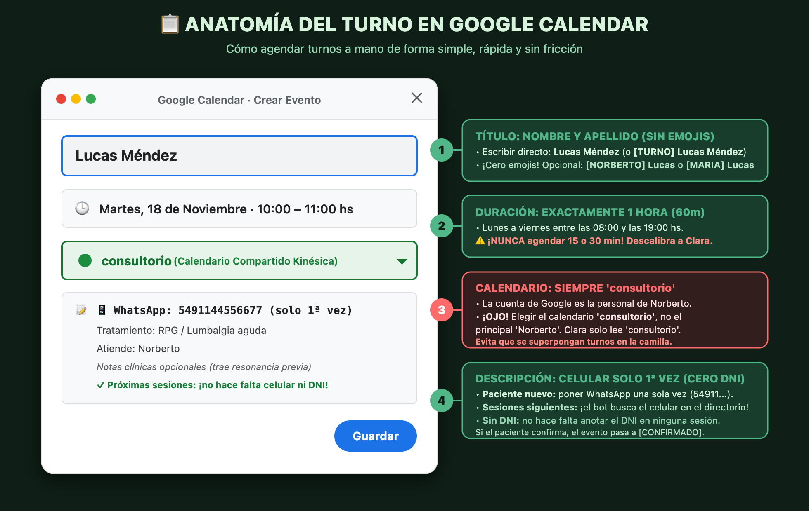
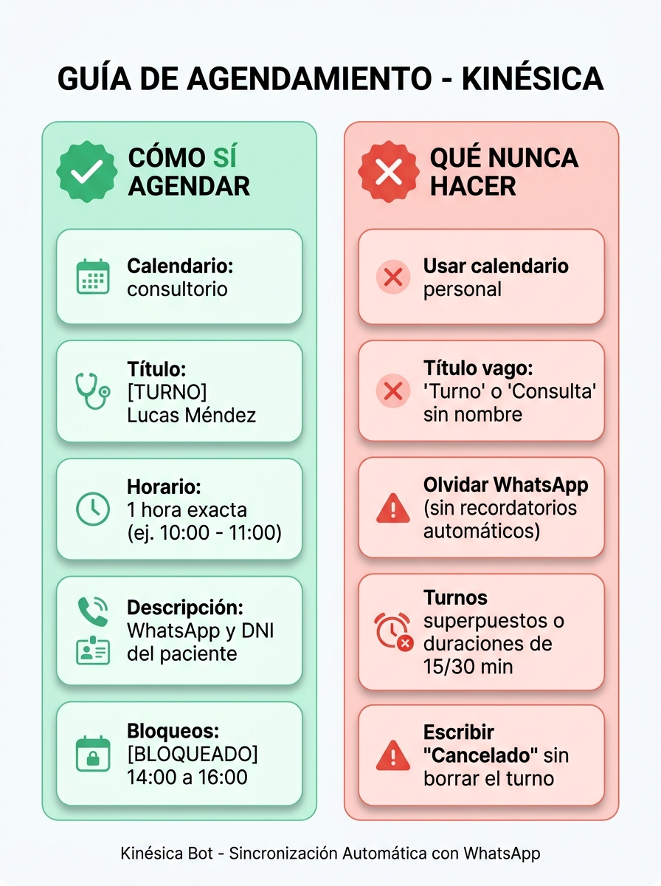
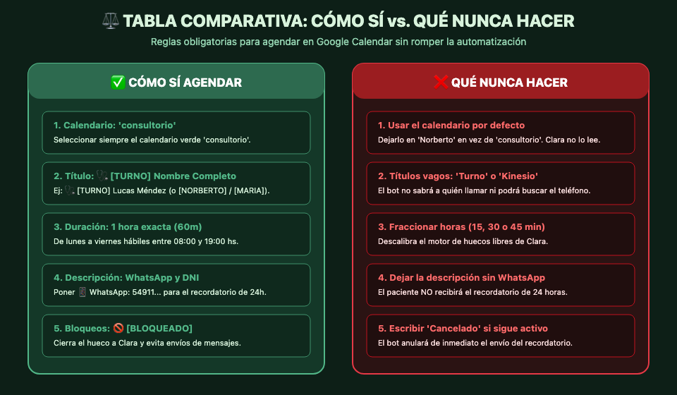
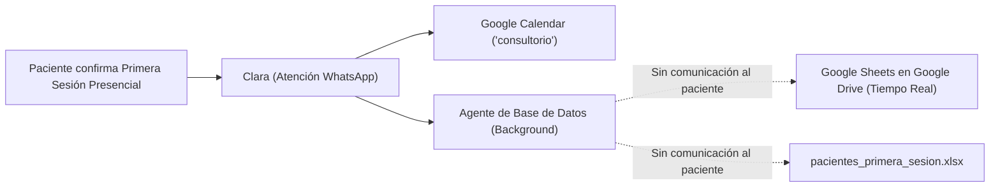

# 🌿 Manual de Clara: La Asistente y Secretaria Virtual de Kinésica
### Guía práctica y operativa del consultorio

> **¿Qué es este documento?**  
> Una explicación simple y clara de cómo funciona **Clara**, cómo atiende a los pacientes que escriben al WhatsApp del consultorio, cómo se organiza con la agenda de Google Calendar y cómo los profesionales del equipo pueden pedirle cosas directamente desde su propio celular.  
> 
> 🔗 **Enlace permanente en GitHub:** [https://github.com/MartinBrude/kinesica/blob/main/docs/manual-clara.md](https://github.com/MartinBrude/kinesica/blob/main/docs/manual-clara.md)  
> 📱 **Cuenta de WhatsApp de Clara:** [Ver paso a paso](CUENTA_WHATSAPP_CLARA.md) ([Enlace en GitHub](https://github.com/MartinBrude/kinesica/blob/main/docs/cuenta-whatsapp-clara.md))  
> 🧪 **Guía Oficial de Pruebas y Casos de Uso:** [Ver Guía de Pruebas](guia-pruebas.md) ([Enlace en GitHub](https://github.com/MartinBrude/kinesica/blob/main/docs/guia-pruebas.md))  
> 🗺️ **Arquitectura y decisiones:** [Manual técnico, secciones 2 y 2.1](MANUAL_TECNICO.md)  
> *(Este enlace se actualiza automáticamente con cada mejora del sistema).*

---

## 👩‍💼 1. ¿Quién es Clara y cuál es su trabajo?

**Clara** es la secretaria de recepción virtual de **Kinésica** (Palermo, CABA). Está conectada al WhatsApp del consultorio las **24 horas del día, los 7 días de la semana**.

### Sus responsabilidades principales:
1. **Atender al instante:** Da una primera respuesta educada y profesional en segundos, evitando que los pacientes queden esperando o se vayan a otro consultorio.
2. **Entender texto y audios de voz:** Si un paciente prefiere mandar un mensaje de voz contando su dolencia en lugar de escribir, Clara escucha el audio de forma invisible, comprende el problema y le responde por escrito con total naturalidad.
3. **Coordinar la agenda:** Ofrece horarios de lunes a viernes hábiles y anota turnos presenciales de una hora en Google Calendar (`consultorio`). No anota llamadas ni bloqueos.
4. **Cuidar el tiempo de los profesionales:** Filtra preguntas repetitivas (dónde queda, horarios, cómo se abona, reintegros) y solo le avisa a Norberto al celular cuando hay un turno nuevo, un cambio o una consulta médica puntual.

---

## 🩺 2. ¿Cómo habla y cómo atiende a los pacientes?

Clara fue configurada con el estilo de una **secretaria médica real de Buenos Aires**: educada, cálida, ubicada, sobria y ejecutiva. Habla de "vos", escribe mensajes cortitos (2 a 3 oraciones para no cansar al que lee) y usa emojis con mucha moderación (🌿, 🩺, 🙌).

### Sus "Reglas de Oro":

* **Escucha activa y presentación fusionada (por única vez):** En el primer mensaje, Clara se presenta cordialmente (*"Hola [Nombre], buen día. Soy Clara de Kinésica 🌿"*) pero responde e integra de inmediato la consulta o dolencia del paciente en esa misma respuesta. Si el paciente ya contó qué le pasa, jamás responde con un sordo "¿en qué te puedo ayudar?".
* **Empatía ante el dolor:** Si alguien escribe diciendo *"me caí de la bici y me duele mucho la rodilla"* o *"tengo una contractura insoportable"*, Clara no le tira los turnos en seco. Primero valida su situación con calidez (*"Qué macana el golpe, para eso te va a venir muy bien la evaluación previa..."*) y luego propone los pasos a seguir.
* **Quiénes atienden:** Clara sabe que los profesionales del consultorio son el **Lic. Norberto Brude** y la **Lic. María Gulín**, pero **solo los nombra si el paciente pregunta expresamente** (*"¿Quién me va a atender?"*). No repite los nombres si no viene al caso.
* **Honorarios ($65.000 ATM / $75.000 resto):** Clara informa con total transparencia los honorarios del consultorio cuando se lo consultan:
  - **$65.000** para ATM (articulación temporomandibular, bruxismo o dolor de mandíbula).
  - **$75.000** para el resto de las consultas y tratamientos (sesiones habituales).
  - **Regla estricta al pedir turno sin aclarar ATM:** Si el paciente solicita un turno presencial y no aclara que es para ATM, Clara le menciona **únicamente el valor de las sesiones habituales ($75.000)**. El valor de $65.000 se informa solo si el paciente especifica ATM, bruxismo o dolor de mandíbula, o bien si consulta de manera abierta/general por la lista de aranceles del consultorio.
  Explica con claridad el valor diferencial: sesiones 100% individuales y exclusivas de 1 hora completa.
* **Obras sociales y prepagas:** Si el paciente pregunta si atienden por OSDE, Swiss Medical, etc., Clara aclara amablemente que se atiende de forma particular para brindar sesiones exclusivas y personalizadas, y que al finalizar se entrega factura oficial para tramitar el reintegro. Si el paciente no pregunta sobre prepagas, Clara no lo menciona.
* **Dirección exacta, Google Maps y Transporte Público:** Informa la dirección (`Charcas 3889, Piso 5º, Dpto B, Palermo`), el enlace oficial de Google Maps ([https://maps.app.goo.gl/urpkh4HYe7dSdjPS9](https://maps.app.goo.gl/urpkh4HYe7dSdjPS9)) y las referencias clave de transporte (a 2 cuadras de Av. Santa Fe, Estación Scalabrini Ortiz del Subte D y Jardín Botánico) al confirmar turno presencial, si lo preguntan o si envían una ubicación por WhatsApp.
* **Atención WhatsApp 24/7 y Franjas Oficiales de Turnos por Profesional:** Clara atiende consultas por WhatsApp las 24 horas, pero los turnos presenciales se realizan **exclusivamente dentro de los horarios oficiales de cada profesional de lunes a viernes hábiles**:
  - **Lic. María Gulín:**
    - **Lunes:** 09:00 a 15:00 hs (turnos de 09:00 a 14:00 hs inclusive; el último turno finaliza a las 15:00 hs).
    - **Martes:** 09:00 a 14:30 hs (turnos de 09:00 a 13:30 hs inclusive; el último turno finaliza a las 14:30 hs).
    - **Viernes:** 09:00 a 13:00 hs (turnos de 09:00 a 12:00 hs inclusive; el último turno finaliza a las 13:00 hs).
    - **Miércoles y Jueves:** No atiende en consultorio.
  - **Lic. Norberto Brude:**
    - **Lunes:** 15:30 a 19:00 hs (turnos de 15:30 a 18:00 hs inclusive; el último turno finaliza a las 19:00 hs).
    - **Martes:** 15:00 a 19:00 hs (turnos de 15:00 a 18:00 hs inclusive; el último turno finaliza a las 19:00 hs).
    - **Miércoles:** 09:00 a 16:00 hs (turnos de 09:00 a 15:00 hs inclusive; el último turno finaliza a las 16:00 hs).
    - **Jueves:** 15:00 a 19:00 hs (turnos de 15:00 a 18:00 hs inclusive; el último turno finaliza a las 19:00 hs).
    - **Viernes:** 13:30 a 19:00 hs (turnos de 13:30 a 18:00 hs inclusive; el último turno finaliza a las 19:00 hs).
  - **Regla Estricta de Duración y Finalización:** *"Si dice de 9 a 13 es que se puede dar turnos de 9 a 12 inclusive"*. Todas las sesiones presenciales duran 60 minutos (1 hora) y deben finalizar estrictamente dentro del horario de atención del profesional. Si un turno creado finaliza fuera de la ventana de atención, o se solicita en sábados, domingos o feriados nacionales, el código lo anula y ofrece alternativas válidas.
  - **Ventana Máxima de Agendamiento (Máximo 60 Días):** Clara y la turnera web pueden otorgar turnos a un **máximo de 60 días corridos a futuro**. Turnos solicitados a más de 60 días son rechazados o deshechos de forma automática.
* **Proactividad de agenda (ofrecer siempre 2 opciones concretas y respetar pedido del paciente):** Cuando el paciente pide disponibilidad para la semana o solicita un día específico (ej: *"¿tenés el jueves?"*) o franja horaria (*"a la tarde"*, *"por la mañana"*), Clara respeta estrictamente esa preferencia y propone proactivamente 2 huecos disponibles libres en Google Calendar. Además, la propuesta se acompaña de **botones nativos de WhatsApp** con las opciones (`[📅 ...]` y `[🔄 Otros horarios]`), reduciendo mensajes y permitiendo confirmar con un solo toque.
* **Sentido común de traslado (turnos para hoy):** Si un paciente escribe pidiendo turno para "hoy", Clara nunca le ofrece un horario que ocurra dentro de los próximos 90 a 120 minutos, para darle tiempo razonable de viajar y llegar tranquilo a Palermo.
* **Paciente habitual:** lo es quien ya tiene al menos un turno creado o confirmado (`sessionsCount` de 1 o más). Escribir por primera vez crea una ficha, pero no lo vuelve habitual.
* **Verificación de profesional:** si es habitual y la ficha no dice si se atiende con Norberto o con María, la única respuesta permitida es *"¿Con qué profesional te venís atendiendo, con Norberto o con María?"*, acompañada de botones nativos (`[Norberto Brude]`, `[María Gulín]` y `[Con cualquiera]`). Al tocar un botón, se asienta de inmediato en la ficha y Clara pasa a ofrecer los horarios de ese profesional. No se ofrecen horarios antes de verificar y, si el modelo creó un evento, se borra. Si el profesional ya figura, se agenda con esa persona. Un paciente nuevo se agenda igual.
* **Nombre y DNI:** a un habitual no se le vuelve a pedir el nombre completo ni el DNI. Si el modelo lo pregunta, esa frase se saca del mensaje antes de enviarlo.
* **Mapeo estricto por disciplina:** Si el paciente solicita en particular una disciplina, Clara sigue este patrón estricto:
  - **Osteopatía:** Norberto
  - **Acupuntura:** María
  - **Reeducación Postural Global (RPG):** cualquiera (Norberto o María)
  - **Neurodinamia:** cualquiera (Norberto o María)
  - **Posturología:** María
  - **Manipulaciones viscerales:** Norberto (también Barral, manipulaciones vicerales o manipulación visceral)
* **Preferencia de no dejar huecos (Norberto y María):** No es una regla. Si el paciente pide un horario que está libre, Clara lo ofrece aunque quede un hueco. Cuando hay varias opciones, prefiere turnos continuos o adyacentes a citas ya agendadas de ese profesional.
* **Metodología no aclarada (primera vez):** Si el paciente de primera vez no aclara metodología, Clara ofrece el primer horario disponible de cualquiera de los dos profesionales dentro de sus franjas oficiales.
* **Solicitud de comunicarse con un profesional:** Si alguien solicita comunicarse con un profesional, Clara informa que se estarán comunicando a la brevedad y notifica inmediatamente a Norberto vía WhatsApp para su seguimiento.
* **Indumentaria para la sesión (solo si el paciente pregunta):** Si el paciente consulta cómo vestir o qué ropa llevar, Clara responde exactamente con la pauta oficial del consultorio:
  - Ropa interior o pantalón corto para los varones.
  - Ropa interior, malla de 2 piezas o calza corta para las mujeres.
  - Si sos menor, vení acompañado/a por un mayor.
  *(Solo se informa si el paciente lo pregunta expresamente; Clara jamás lo menciona por iniciativa propia).*
* **Requisitos para agendar y privacidad del nombre de WhatsApp:** Clara **nunca toma ni asume el nombre de perfil o apodo de WhatsApp del paciente**. A los pacientes nuevos los saluda cordialmente sin nombre (*"Hola, buen día. Soy Clara de Kinésica 🌿"*) y les solicita su **Nombre completo** (nombre y apellido) y su **DNI o documento de identidad** al momento de coordinar la cita.
  - **Si el paciente no quiere dar su DNI, ¡se le da turno igual! (Botón nativo de escape):** Al solicitar los datos, Clara adjunta dos botones interactivos: `[Prefiero no dar DNI]` y `[🔄 Cambiar horario]`. Si el paciente manifiesta que no quiere dar su DNI, que prefiere no brindarlo, no lo tiene a mano, toca el botón de escape o simplemente brinda su nombre completo y confirma el horario sin dar el documento, **está perfectamente bien y se le otorga el turno igual**. Clara jamás insiste, rechaza ni bloquea al paciente: procede a agendar normalmente en Google Calendar registrando en la descripción: `🪪 DNI: No provisto`. Lo único indispensable y excluyente es contar con el Nombre Completo.
  - **Aceptación amplia de formatos (extranjeros, personas mayores y jóvenes):** El documento de un extranjero (pasaporte alfanumérico, DNI de radicación serie 90M, cédula de identidad), de una persona mayor (DNI o Libreta Cívica/Enrolamiento de 6 o 7 dígitos) y de una persona joven (DNI de 8 dígitos) presenta características diversas. Clara **acepta el número o identificación que le den**, sin cuestionar la cantidad de cifras ni exigir un formato estricto.
* **Privacidad de ubicación y seguridad (Zona vs. Dirección Exacta):**
  - **Dirección completa:** Si preguntan dónde queda, cómo llegar o al confirmar un turno, Clara informa `Charcas 3889, 5º, B, CABA` y el enlace de Google Maps. Puede sumar que está a 2 cuadras de Scalabrini Ortiz (Subte D) y de Av. Santa Fe.
* **Confirmación de agendamiento, desear buen día y condiciones del espacio:**
  - **Certeza y seguridad del agendamiento:** Al asentar la cita en Google Calendar, Clara le informa explícitamente al paciente que el evento ya quedó **AGENDADO** en la agenda oficial (*"¡Listo [Nombre]! Ya quedó agendado tu turno para este [Día] a las [Hora] hs en el consultorio"*), brindándole total tranquilidad.
  - **Despedida cálida:** En el cierre del mensaje de confirmación, Clara siempre le desea cordialmente un buen día (*"¡Que tengas un muy lindo día y te esperamos! 🙌"*).
  - **Sin sala de espera:** El consultorio no cuenta con sala de espera.
  - **No asistir con acompañantes:** Se solicita a los pacientes asistir solos (salvo menores de edad, que deben concurrir con un adulto responsable, o pacientes que requieran asistencia directa para movilizarse).
  - **Puntualidad estricta:** Se enfatiza la puntualidad estricta para evitar esperas en la entrada o en la calle. Clara jamás solicita llegar con 10 o 15 minutos de anticipación.
* **Recepción y reenvío de archivos adjuntos (fotos y PDFs):** Si un paciente envía fotos de órdenes médicas, estudios, radiografías o comprobantes de pago, Clara acusa recibo al instante y se lo reenvía a Norberto con todo el contexto del paciente.
* **Contacto personal con Norberto o María (Gestión de Horario):** Si un paciente pide hablar personalmente con Norberto o María:
  - En horario de atención (08:00 a 20:00 hs hábiles): avisa que el profesional se contactará a la brevedad.
  - Fuera de horario (noches después de las 20 hs, madrugadas, fines de semana o feriados): aclara con calidez que ya les transmitió la consulta y que se estarán comunicando **al comenzar el próximo día hábil por la mañana**, evitando que el paciente espere una llamada en plena noche.
* **Trato al paciente únicamente por su nombre de pila (cero apellidos):** Clara llama al paciente **siempre y exclusivamente por su nombre de pila** (ej: *"Hola Lucas"*, *"¡Listo Lucas!"*, *"Florencia"*, *"Juan Ignacio"*). **Jamás** lo llama por su nombre y apellido juntos (prohibido *"Hola Lucas Méndez"* o *"Listo Lucas Méndez"*). Si el paciente se presenta diciendo su nombre y apellido, Clara lo saluda tratándolo solo por el nombre. Los nombres completos se reservan para el registro administrativo en Google Calendar y las alertas internas a los kinesiólogos.
* **Privacidad estricta:** Clara jamás revela nombres ni horarios de otros pacientes. Si alguien pregunta *"¿a qué hora tiene turno mi marido?"* o *"¿quién está a las 16 hs?"*, Clara responde con firmeza profesional que por confidencialidad médica no puede brindar datos de terceros. Si el modelo igual escribe el nombre o el teléfono de otro turno que está en la agenda, el código saca ese dato y deja solo la frase de confidencialidad.
* **Disciplina y profesional:** El código corrige el nombre si la respuesta asigna al profesional equivocado, sin importar mayúsculas ni un error corto de tipeo. Osteopatía y manipulaciones viscerales (Barral es el mismo nombre) quedan con Norberto. Acupuntura y posturología quedan con María. Reeducación Postural Global (RPG) y neurodinamia pueden ser cualquiera de los dos.
* **Vacaciones:** Un evento de día entero titulado «Vacaciones» cierra ese día. Clara no ofrece ni confirma un turno ahí. Lo que ya estaba en el calendario no se borra, salvo el turno que ella misma acaba de crear en ese mensaje.
* **Recordatorios interactivos con 3 botones de WhatsApp:** Los recordatorios de 24h se envían como Plantilla Oficial de Meta (*Message Template* de Utilidad) e incluyen tres botones nativos de respuesta rápida:
  - `[✅ Confirmo]`: Actualiza Google Calendar automáticamente a `[CONFIRMADO]`.
  - `[🔄 Reprogramar]`: Abre la renegociación cordial de la cita, ofreciendo dos nuevas opciones disponibles.
  - `[❌ Cancelar]`: Anula y libera el turno en Google Calendar al instante, notifica a Norberto y verifica automáticamente la Lista de Espera Inteligente si hay pacientes aguardando ese hueco.
* **Registro interno de turnos ofrecidos y retención de 10 minutos (Anti-Colisión):** Clara evita activamente ofrecer el mismo horario a dos pacientes en simultáneo. Cuando Clara propone opciones de horarios a un paciente, guarda un registro interno y bloquea temporalmente esos turnos durante **10 minutos** para que ninguna otra persona pueda tomarlos mientras decide. Si el primer paciente confirma o declina, la retención se actualiza de inmediato. Si pasan más de 10 minutos sin respuesta, la retención expira y el horario vuelve a quedar libre. Si durante ese lapso otro paciente reservó el turno y el primer paciente vuelve más tarde solicitándolo, Clara **disculpa cordialmente el inconveniente, le explica que otro paciente tomó ese turno durante la espera** y le ofrece de inmediato nuevas opciones disponibles.
* **Integración de técnicas en las sesiones (solo si el paciente pregunta):** En Kinésica no se contrata una técnica u otra de forma aislada. En cada sesión es posible y habitual que los kinesiólogos utilicen y combinen diversas herramientas (RPG, osteopatía, terapias manuales, abordaje postural) empleando todos sus recursos terapéuticos para el bienestar y evolución del paciente. Clara tiene esto muy claro, pero **lo aclara únicamente si el paciente lo consulta expresamente** (ej: si pregunta si puede elegir técnica o si se contratan por separado). **Jamás lo dice porque sí ni por iniciativa propia**.
* **Consultas por masajes (entender como sesiones y responder siempre hablando de sesiones):** Si un paciente consulta por masajes (ya sea masajes para dolor de espalda, masajes de bruxismo, masajes descontracturantes o cualquier combinación), Clara comprende de inmediato que en Kinésica se habla de **sesiones** (sesiones de kinesiología y terapias manuales de 1 hora, o sesiones de ATM/bruxismo). Clara **jamás rechaza al paciente** diciendo que no hace masajes, ni adopta la palabra "masajes" para referirse a los servicios del consultorio; responde **siempre hablando de sesiones**, valida el motivo de consulta con empatía sobria y ofrece coordinar la sesión presencial de 1 hora, informando los honorarios oficiales si el paciente los consulta ($65.000 para ATM/bruxismo y $75.000 para dolor de espalda o resto de las consultas).
* **Kinesiología Respiratoria (No se realiza):** En Kinésica **no se realiza kinesiología respiratoria** (ni pediátrica/infantil ni de adultos). Si consultan por respiratorio, Clara aclara con calidez que no se atiende esa especialidad y que el consultorio está especializado en kinesiología traumatológica, RPG, ATM, osteopatía y columna.
* **Kinesiología Domiciliaria (Derivación directa a Norberto):** Si un paciente consulta o solicita atención a domicilio, Clara le informa cordialmente que le transmite la consulta a Norberto para que se comunique directamente con él/ella y coordine la posibilidad de atención. Dispara de inmediato la alerta `[DERIVAR_A_NORBERTO]` a Norberto para que continúe él la comunicación.
* **Capacidad física (1 sola camilla):** El consultorio cuenta con **una única camilla física de atención**. La atención es 100% individual y secuencial; nunca pueden superponerse dos turnos en el mismo horario.
* **Agendamiento de a un turno a la vez:** Si un paciente solicita agendar turnos para dos o más personas (ej: para él y su pareja/familiar) o varias citas en simultáneo, Clara aclara amablemente que se agenda **de a un turno a la vez**, coordinando primero el turno inicial y, una vez concluido, el siguiente.
* **Confirmación de turnos (Like / Reacción 👍 y Cero Confirmación Condicional):**
  - **Confirmación con Like:** Si el paciente responde a un recordatorio o consulta reaccionando con un "like" (👍) o enviando "👍" / "de una", Clara acepta la confirmación y asienta `[CONFIRMADO]` en Google Calendar.
  - **No se acepta confirmación condicional:** Si el paciente responde con dudas, demoras o condiciones (*"llego 15 min tarde pero voy"*, *"te confirmo mañana"*, *"veo si llego"*), Clara **no confirma el turno**. Solicita amablemente una confirmación certera o propone reprogramar para no bloquear innecesariamente la única camilla del consultorio.
* **Función operativa de Clara:** Clara tiene por función principal **atender las comunicaciones entrantes** de los pacientes de kinesiología. La gestión de cancelaciones masivas o avisos personales por imprevistos del profesional la realizan a mano los propios kinesiólogos.
* **Solicitud de atención con kinesióloga mujer (Derivación a María vía Norberto):** Si un paciente manifiesta preferencia o pide atenderse específicamente con una profesional mujer o kinesióloga mujer, Clara le informa cordialmente que no hay ningún inconveniente (*"¡Por supuesto, no hay ningún problema! 🙌 En el equipo contamos con la Lic. María Gulín. Ya le paso tu consulta a Norberto para que coordine la derivación con María y se contacten directamente con vos a la brevedad."*). Clara dispara de inmediato una alerta automática a Norberto para que gestione la derivación interna con María y se contacte con el paciente.

### 🔘 2.1. Botoneras Interactivas de WhatsApp (Flujo Determinista y Cero Fricción)

Para eliminar ambigüedades, acelerar las respuestas y brindar una experiencia moderna e intuitiva en el celular del paciente, Clara utiliza **botones interactivos nativos de WhatsApp** en 5 momentos clave del diálogo:

| Escenario | Botones que ve el paciente | Función operativa y efecto |
|---|---|---|
| **1. Selección de Horarios Proactivos** | `[📅 Lun 14/10 10:00]`<br>`[📅 Mar 15/10 16:30]`<br>`[🔄 Otros horarios]` | Ofrece los 2 mejores huecos libres según el día o franja solicitada por el paciente. Con un solo toque, el paciente elige el turno sin tener que escribirlo a mano. El botón de otros horarios solicita nuevas alternativas. |
| **2. Profesional en Paciente Habitual** | `[Norberto Brude]`<br>`[María Gulín]`<br>`[Con cualquiera]` | Si un paciente recurrente escribe sin tener profesional asignado en su ficha, Clara le consulta con quién se atiende mediante botones rápidos para abrir la disponibilidad de ese profesional. |
| **3. Flexibilidad de DNI al pedir datos** | `[Prefiero no dar DNI]`<br>`[🔄 Cambiar horario]` | Al solicitar Nombre y DNI a un paciente nuevo, Clara incluye un botón de escape: si el paciente toca `[Prefiero no dar DNI]`, el bot agenda la cita sin trabas registrando `🪪 DNI: No provisto`. |
| **4. Doble Check de Cancelación / Reprogramación** | `[❌ Cancelar turno]`<br>`[🔄 Reprogramar]`<br>`[🔙 Mantener turno]` | Si el paciente solicita anular o mover su turno, Clara no borra a ciegas: presenta la botonera con opción de seguridad. Si el paciente toca `[🔙 Mantener turno]`, su cita sigue 100% reservada e intacta. |
| **5. Recordatorios de 24 Horas** | `[✅ Confirmo]`<br>`[🔄 Reprogramar]`<br>`[❌ Cancelar]` | Los recordatorios automáticos llegan con tres botones nativos. Al tocar `[✅ Confirmo]`, Google Calendar se actualiza automáticamente anteponiendo `[CONFIRMADO]` en la agenda. |

### 🛡️ El Validador de Calidad en Tiempo Real (Doble Modelo / Guardrail):
Antes de que cualquier mensaje salga hacia el WhatsApp del paciente, la propuesta de respuesta pasa automáticamente por un **segundo modelo de inteligencia artificial (Auditor Clínico)**. Este segundo modelo revisa en milisegundos que se cumplan todas las reglas médicas y de estilo:
1. Verifica que se informen con exactitud y transparencia los **honorarios oficiales vigentes** ($65.000 ATM / $75.000 resto), y que **al pedir turno sin aclarar ATM se informe únicamente el valor habitual ($75.000)**.
2. Verifica que **no se pida llegar antes** de la sesión.
3. Verifica la **privacidad total** de otros pacientes.
4. Verifica que Clara se dirija al paciente **únicamente por su nombre de pila** (si accidentalmente incluyó el apellido, lo elimina al instante).
5. Verifica que **no haya superposiciones ni colisiones de agenda** (audita los eventos de Google Calendar y, si Clara propuso o confirmó un horario solapado con un turno existente, corrige el mensaje informando que está ocupado y ofreciendo alternativas libres; complementado con una guarda determinista de código que intercepta colisiones).
6. Verifica el **mapeo estricto por disciplina** (Osteopatía y manipulaciones viscerales, también Barral, a Norberto; Acupuntura/Posturología a María; Reeducación Postural Global y RPG son la misma disciplina).
7. Verifica que para **pacientes habituales** se consulte con qué profesional se atienden antes de dar horarios posibles.
8. Verifica la **indumentaria sugerida** (ropa interior o pantalón corto para varones; ropa interior, malla de 2 piezas o calza corta para mujeres; solo si el paciente preguntó).
9. Verifica que, si preguntan dónde queda o se confirma un turno, la respuesta incluya la dirección completa (`Charcas 3889, 5º, B, CABA`).
10. Verifica que la confirmación contenga las **condiciones del espacio y puntualidad estricta** (sin sala de espera ni acompañantes).
11. Verifica los **requisitos de agendamiento**: si Clara confirma un turno sin Nombre Completo y DNI, el validador frena la confirmación y solicita los datos faltantes.
12. Pule el tono para que sea siempre sobrio, empático y profesional.  
*Si detecta cualquier desvío, el validador corrige y limpia la respuesta antes de enviarla, asegurando una atención 100% segura y confiable.*

---

## 📅 3. Guía Maestra de Google Calendar: Cómo Funciona por Detrás, Qué Deben Hacer y Qué NO

> 🎯 **Objetivo de esta sección:**  
> Esta es la guía operativa indispensable para **Norberto, María y cualquier persona que administre la agenda de Kinésica**. Explica con ilustraciones, capturas y diagramas exactamente cómo funciona el motor del bot detrás de escena, qué deben hacer ustedes al cargar o modificar turnos a mano, y cuáles son los errores que jamás deben cometerse para asegurar que ningún paciente quede sin recordatorio y evitar superposiciones de camilla.

> [!IMPORTANT]
> **La cuenta de Google del consultorio es la cuenta personal de Norberto (`norberto1712@gmail.com`):**  
> No existe una cuenta de Google separada para Kinésica ni tienen que cambiar de usuario en el celular o la computadora. Norberto usa su cuenta personal de siempre (y María accede al calendario compartido desde su propia cuenta).  
> **La clave operativa está dentro de Google Calendar:**  
> En la cuenta de Norberto conviven su calendario principal por defecto (titulado `"Norberto Brude"` o `"Eventos"`) y el calendario del consultorio (**`consultorio`**, con color verde).  
> **Clara y el bot de recordatorios están conectados única y exclusivamente al calendario `consultorio`**.

---

### ⚙️ 3.1. ¿Cómo funciona por detrás? (El Cerebro del Sistema)

Clara y el bot de recordatorios operan conectados directamente al calendario compartido **`consultorio`** en Google Calendar:

<p align="center">
  
  <br>
  <em>Figura 1: Arquitectura y sincronización entre Google Calendar, Clara y el bot de recordatorios.</em>
</p>

El flujo técnico detrás de escena se basa en cinco pilares automatizados:

1. 🏛️ **El Calendario `consultorio` como Fuente Única de Verdad (*Single Source of Truth*):**  
   Clara y el sistema de recordatorios no almacenan una agenda paralela ni adivinan horarios: en cada mensaje, consultan en tiempo real la API de Google Calendar sobre el calendario `consultorio`. Lo que figura en ese calendario determina con precisión matemática la disponibilidad del consultorio.
2. 🛏️ **Principio de Camilla Única Física y Motor de Huecos Libres (*Free-Slot Engine*):**  
   Kinésica cuenta con **una única camilla física de atención**. La atención es 100% individual y secuencial. El motor algorítmico solo ofrece huecos de **1 hora completa** de lunes a viernes hábiles entre las **08:00 y las 19:00 hs**. Cualquier evento existente en el calendario bloquea la totalidad del intervalo; si un evento ocupa de 10:15 a 10:45 hs, el motor invalida automáticamente tanto las 10:00 como las 11:00 hs para proteger la camilla de colisiones.
3. ⏳ **Hold Temporal Anti-Colisión (10 minutos):**  
   Cuando un paciente solicita turnos por WhatsApp y Clara le ofrece opciones, el sistema genera una retención interna de **10 minutos** sobre esos huecos. Si un segundo paciente consulta al mismo tiempo, verá esos horarios como ocupados. Si el primer paciente confirma, el turno se asienta en Google Calendar; si pasan 10 minutos sin confirmación, el turno vuelve a quedar disponible para los demás.
4. ⏰ **Motor de Recordatorios Automáticos de 24 Horas (Cron n8n):**  
   Se dispara automáticamente en dos momentos estratégicos para cuidar el descanso de los pacientes:
   - **Domingos a las 18:00 hs:** Busca los turnos del lunes siguiente.
   - **Lunes a Jueves a las 10:00 hs:** Busca los turnos del día hábil posterior (martes a viernes).
   - *(Los viernes y sábados no se despachan recordatorios porque el consultorio no atiende fines de semana).*  
   Al ejecutarse:
   - **Filtra cancelaciones y bloqueos:** Ignora eventos con status cancelado o que contengan en título o descripción palabras como `[CANCELADO]`, `[ANULADO]`, `[SUSPENDIDO]`, `[BAJA]`, `[BLOQUEADO]`, `feriado` o `vacaciones`.
   - **Extrae el nombre de pila:** Clara limpia etiquetas y apellidos para saludar con empatía y cercanía (*"¡Hola Lucas! 🌿"* en vez del frío *"Hola Lucas Méndez"*).
   - **Resuelve el número de WhatsApp:** Primero busca el teléfono en la **descripción** o título del evento (`📱 WhatsApp: 54911...`). Si no figura en el evento, recurre al **Directorio Dinámico de Pacientes** de Kinésica. Si el teléfono no está ni en la cita ni en el directorio, el sistema no puede despachar el mensaje y el paciente se queda sin recordatorio.
5. 🔄 **Actualización e Impacto Bidireccional en Tiempo Real:**  
   - Si el paciente toca **`[✅ Confirmo]`** en WhatsApp, el bot acusa recibo y edita automáticamente el evento en Google Calendar anteponiendo `[CONFIRMADO]` al título (ej: `🩺 [CONFIRMADO] Lucas Méndez`).
   - Si el paciente toca **`[🔄 Reprogramar]`**, Clara abre la renegociación cordial y le ofrece dos nuevos huecos libres.
   - Si el paciente toca **`[❌ Cancelar]`**, el sistema elimina o anula el turno en Google Calendar, le avisa a Norberto y comprueba si hay pacientes en la **Lista de Espera Inteligente** para ofrecerles el hueco liberado.

---

### 🟢 3.2. ¿Qué DEBEN hacer Norberto y María? (Guía Paso a Paso con Capturas)

Cuando Norberto o María agendan un turno a mano en Google Calendar (desde la web o desde la app del celular), deben completar la cita siguiendo este estándar exacto:

<p align="center">
  
  <br>
  <em>Figura 2: Captura real del formulario de agendamiento en Google Calendar (consultorio).</em>
</p>

<p align="center">
  
  <br>
  <em>Figura 3: Los 4 campos obligatorios y sus reglas para no romper el proceso.</em>
</p>

#### 📝 Los 4 Campos Obligatorios del Turno Perfecto:

1. **Calendario (OBLIGATORIO):**  
   - Seleccionar siempre el calendario **`consultorio`** (color verde).  
   - > [!CAUTION]  
     > **¡El detalle más importante!** Al usar la cuenta personal de Norberto, Google Calendar muchas veces ofrece por defecto el calendario personal `"Norberto Brude"`. Si el turno queda guardado en `"Norberto Brude"`, Clara es completamente ciega a ese evento: creerá que el consultorio está vacío y le dará el mismo turno a un paciente por WhatsApp, provocando una superposición en la camilla.  
     > **Compromisos personales de Norberto en horario de atención (08 a 19 hs):** Si Norberto tiene un médico, trámite o almuerzo durante el horario laboral, debe anotarlo en **`consultorio`** con el título `🚫 [BLOQUEADO]`. De esa forma Clara respeta su horario y el bot sabe que no debe enviar ningún recordatorio.

2. **Título del Evento (Summary):**  
   - **¡Cero emojis obligatorios!** No hace falta colocar ningún emoji (🩺, 🌿, etc. no son requeridos).
   - **Formato directo:** Escribir simplemente el nombre y apellido del paciente:  
     `Lucas Méndez` (o `[TURNO] Lucas Méndez` si prefieren esa etiqueta).
   - **Identificación opcional de profesional:** Si desean asentar quién de los dos atiende:  
     `[NORBERTO] Lucas Méndez`  
     `[MARIA] Lucas Méndez`
   - **Menor de edad:** Si asiste acompañado/a por un adulto responsable:  
     `Lucas Méndez (Familiar: Andrea Gómez)` o `[TURNO - MENOR] Lucas Méndez (Familiar: Andrea Gómez)`  
     *(El sistema detecta automáticamente la condición de menor y añade en el recordatorio la indicación de asistir con un adulto).*

3. **Horario y Duración:**  
   - Duración: **Exactamente 1 hora (60 minutos)**.  
   - Ejemplos válidos: `10:00 a 11:00 hs`, `15:00 a 16:00 hs`, `18:00 a 19:00 hs`.  
   - Franja oficial: Lunes a viernes hábiles de 08:00 a 19:00 hs.

4. **Descripción del Evento (Notas):**  
   - **El teléfono celular solo es necesario la PRIMERA VEZ:**
     - **Paciente nuevo (primera consulta en Kinésica):** Anotar su número con código de área (ej: `📱 WhatsApp: 5491144556677` o `1144556677`) la primera vez que se carga la cita a mano. Al procesar el recordatorio, el sistema indexa y guarda el celular automáticamente en el **Directorio Dinámico de Pacientes**.
     - **Pacientes habituales (2ª sesión en adelante):** **¡Ya no hace falta poner el teléfono!** Norberto y María simplemente crean el evento con el nombre del paciente (`Lucas Méndez`). El bot de recordatorios de las 24 hs busca automáticamente el nombre en el Directorio y le despacha el WhatsApp sin tener que tipear el número nunca más.
   - **Cero exigencia de DNI en cada sesión:**
     - **No tiene ningún sentido cargar el DNI cada sesión.** El DNI se registra una sola vez en la ficha de admisión o cuando Clara agenda por chat. Para agendar turnos manuales día a día, Norberto y María **jamás están obligados a cargar el DNI**.
   - **Notas clínicas (opcionales):** La descripción puede dejarse vacía o aprovecharse únicamente para anotaciones terapéuticas si lo desean:
     ```text
     📱 WhatsApp: 5491144556677 (solo indispensable la 1ª vez)
     Motivo: Lumbalgia y evaluación postural
     Atiende: Norberto
     Trae resonancia magnética lumbar previa
     ```

---

#### 🚫 Cómo Bloquear Horarios para No Atender (Almuerzos, Cursos, Trámites)
Si Norberto o María necesitan ausentarse o cerrar un horario específico del consultorio:
- Crear un evento en el calendario **`consultorio`** que cubra el rango deseado (ej: jueves de 13:00 a 15:00 hs).
- Título obligatorio: `🚫 [BLOQUEADO]` o `🚫 [BLOQUEADO] Trámite personal`.
- **Efecto automático:** Clara detectará el hueco como ocupado y jamás ofrecerá ese horario a los pacientes. Además, el bot de recordatorios ignorará este evento y no mandará ningún mensaje.

#### 🏖️ Cómo Cargar Vacaciones o Receso del Consultorio
- Crear un evento de **día completo** en el calendario **`consultorio`**.
- Título: `🏖️ [VACACIONES CONSULTORIO - CERRADO]` o `Vacaciones`.
- **Efecto automático:** Clara informará con calidez a los pacientes que escriban que el consultorio está en receso y ofrecerá turnos para las fechas posteriores al regreso.

#### ❌ Cómo Cancelar o Anular un Turno a Mano
Si un paciente les avisa directamente a ustedes por llamada o chat personal que no va a asistir:
- **Opción A (Recomendada):** Abrir el evento en Google Calendar y **eliminarlo** (tacho de basura). El hueco queda liberado al instante para Clara.
- **Opción B (Registro histórico):** Si prefieren conservar el registro, editen el título agregando `[CANCELADO]` o `[ANULADO]` al inicio (ej: `[CANCELADO] 🩺 [TURNO] Lucas Méndez`). El bot de recordatorios detectará la palabra y **no le enviará el WhatsApp**.

---

### 🔴 3.3. ¿Qué NUNCA deben hacer? (Los 7 Errores Críticos que Rompen el Proceso)

Para mantener la armonía entre el equipo humano y la inteligencia artificial de Clara, nunca cometan estas 7 equivocaciones:

<p align="center">
  
  <br>
  <em>Figura 4: Póster resumen de Qué SÍ hacer y Qué NUNCA hacer.</em>
</p>

<p align="center">
  
  <br>
  <em>Figura 5: Matriz visual de causa y efecto en la automatización de agenda.</em>
</p>

| # | ❌ Qué NUNCA hacer | 💥 Qué pasa por detrás | ✅ Qué deben hacer en su lugar |
|---|---|---|---|
| **1** | **Dejar el turno en el calendario por defecto `"Norberto Brude"`** | Al estar en la cuenta personal de Norberto, Clara solo lee el calendario `consultorio`. Si queda en el calendario por defecto de Norberto, Clara no lo ve y asignará un turno en el mismo horario. | Seleccionar siempre el calendario **`consultorio`** en el desplegable. |
| **2** | **Poner títulos vagos sin nombre:** `"Turno"`, `"Paciente"`, `"RPG"`, `"Kinesio"` | El bot no sabe a quién pertenece la cita, no puede extraer el nombre de pila y, si falta el teléfono, no puede resolverlo en el directorio. | Escribir el nombre del paciente: `Lucas Méndez` (o `[TURNO] Lucas Méndez`). ¡Sin emojis obligatorios! |
| **3** | **No anotar el celular si el paciente es nuevo** | Si el paciente nunca vino antes a Kinésica y no se coloca su WhatsApp en la 1ª sesión, el bot no sabrá adónde enviar el aviso de 24 hs. (En pacientes habituales no hace falta). | Escribir en la descripción `📱 WhatsApp: 54911...` **solo la primera vez**. En las siguientes el bot lo busca solo en el directorio. |
| **4** | **Superponer eventos o encimar horarios** | En Kinésica hay **1 sola camilla física**. Si agendan a dos pacientes a la misma hora o pisan una cita previa, colapsa la atención presencial. | Chequear que el bloque horario esté completamente libre antes de guardar. |
| **5** | **Crear turnos con duraciones no estándar** (15 min, 30 min o 45 min) | Descalibra la grilla de turnos de Clara, generando huecos inutilizables o solapamientos con la próxima sesión de 1 hora. | Todos los turnos deben durar **exactamente 60 minutos** (de hora en punto a hora en punto). |
| **6** | **Escribir `"Cancelado"` en un turno que sigue activo** | El filtro anti-cancelación detectará la palabra clave y **anulará de inmediato el recordatorio de 24 hs**. El paciente pensará que nadie lo espera. | Usar `"Cancelado"` únicamente cuando la cita haya sido verdaderamente anulada. |
| **7** | **Pedirle a Clara por WhatsApp que les agende un turno a ustedes** | Clara reconoce sus celulares como administradores. Les responderá: *"Los turnos son para los pacientes, no para los kinesiólogos"*. | Los bloqueos y turnos manuales los cargan ustedes directamente en Google Calendar. |

---

### 📲 3.4. El Resultado Final: ¿Qué recibe el paciente 24 horas antes?

Cuando un turno se agenda correctamente en Google Calendar, el bot de recordatorios se activa a las 10:00 hs (o domingos a las 18:00 hs) y despacha automáticamente una plantilla interactiva oficial de WhatsApp:

<p align="center">
  
  <br>
  <em>Figura 6: Mensaje oficial interactivo de WhatsApp recibido por el paciente 24 horas antes con los 3 botones de confirmación rápida.</em>
</p>

#### 🔘 Los 3 Botones Interactivos Nativos y su Acción:
1. **`[✅ Confirmo]`**:  
   El paciente confirma su presencia con un solo toque. El sistema actualiza Google Calendar al instante cambiando el título a **`🩺 [CONFIRMADO] Nombre Paciente`**, permitiendo que Norberto y María vean de un vistazo en la agenda quiénes ya confirmaron para el día.
2. **`[🔄 Reprogramar]`**:  
   El paciente solicita un cambio. Clara responde de inmediato consultando los huecos libres disponibles en Google Calendar y proponiéndole 2 nuevas alternativas sin intervención humana.
3. **`[❌ Cancelar]`**:  
   El paciente avisa que no puede asistir. El sistema anula o elimina el evento en Google Calendar liberando la camilla, le envía una notificación inmediata a Norberto y revisa si hay alguien en **Lista de Espera** para avisarle del lugar disponible.

---

## 🔔 4. ¿Qué notificaciones le llegan a Norberto y a María a su celular?

Para no llenarle el WhatsApp de mensajes innecesarios, **Clara no avisa cuando un paciente solo hace preguntas informativas**.

**Solo envía una alerta automática cuando hay algo importante que requiere atención:**

1. 📌 **Nuevo turno confirmado:**  
   > *📌 NUEVO TURNO EN KINÉSICA*  
   > • *Paciente:* Lucas Méndez  
   > • *WhatsApp:* wa.me/54911...  
   > • *Mensaje:* "Quería un turno para este jueves a las 16 hs"  
   > • *Respuesta de Clara:* "Te esperamos este jueves a las 16:00 hs..."
2. 🔄 **Turno reprogramado:**  
   Avisa si un paciente movió su cita a otro día u horario.
3. 🚨 **Cancelación urgente del mismo día:**  
   Si alguien avisa a último momento que no puede ir a su turno de hoy, Clara dispara una alerta prioritaria avisando que **se liberó un hueco para hoy** e indica si hay alguien en lista de espera disponible para ocuparlo.
4. ⚠️ **Consultas profesionales y derivaciones (Especialidades de Norberto, María o Azar si ambos pueden responder):**  
   - **Especialidades de Norberto (Osteopatía, Manipulaciones viscerales / Barral) o pedido directo de Norberto:** Clara informa al paciente que Norberto Brude se contactará a la brevedad y despacha la alerta directamente a **Norberto (`+54 11 6156-4311`)**.
   - **Especialidades de María (Acupuntura, Posturología, Suelo pélvico) o pedido directo de María:** Clara informa al paciente que la Lic. María Gulín se contactará a la brevedad y despacha la alerta directamente a **María (`11 2853-1224`)**.
   - **Disciplinas compartidas (RPG / Reeducación Postural Global, Neurodinamia) o consultas generales donde ambos pueden responder ("con un profesional", "con el kinesiólogo", "con Norberto o María"):** Ambos profesionales pueden responder, por lo que el sistema **elige al azar entre ellos dos (50/50)** y despacha **exactamente 1 alerta** al profesional seleccionado al azar para su contacto directo, evitando saturar a ambos profesionales.
   - **Solicitud de kinesióloga mujer:** Clara confirma la disponibilidad de la Lic. María Gulín y notifica a **Norberto (`+54 11 6156-4311`)** para coordinar la derivación interna con María.
   - **Solicitud de atención a domicilio:** Se informa y alerta directamente a **Norberto (`+54 11 6156-4311`)** para que continúe él personalmente la comunicación.
5. 📎 **Archivos adjuntos (estudios médicos, órdenes o comprobantes):**  
   Cuando un paciente manda una foto o PDF, Clara acusa recibo y le envía a Norberto una alerta inmediata con el nombre, mensaje, tipo de archivo y el enlace directo `wa.me/...` para abrir el chat del paciente y ver o descargar el original con un solo toque.
6. 🌐 **Nueva reserva realizada desde la web (`turnos.html`):**  
   Cuando un paciente agenda directamente a través del motor de reservas del sitio web ([`kinesica.com.ar/turnos.html`](https://www.kinesica.com.ar/turnos.html)), Google Apps Script crea el evento en Google Calendar y le envía automáticamente a Norberto una alerta por WhatsApp con el tipo de cita (Turno 1h), datos del paciente, DNI, motivo y notas.
   - **Compatibilidad total con Clara:** Los eventos creados en la web (con formato `🩺 [NORBERTO] [TURNO] Nombre`, `🩺 [MARIA] [TURNO] Nombre` o `🩺 [TURNO - MENOR] Nombre (Familiar: Tutor)`) son reconocidos de forma nativa por Clara.
   - **Directorio Dinámico de Pacientes:** El número de WhatsApp del paciente se indexa automáticamente en el directorio de Kinésica. Si en el futuro Norberto o María agendan a ese paciente escribiendo solo su nombre sin teléfono en Google Calendar, el bot de recordatorios resuelve el teléfono desde el directorio y le despacha el recordatorio con su nombre de pila.
   - **Acompañamiento de menores:** Si el turno proviene de la web con indicación de menor y familiar, el recordatorio agrega automáticamente la indicación de concurrir acompañado por un adulto responsable.
7. ⏳ **Protección contra colisión entre pacientes simultáneos (Hold de 10 minutos):**  
   Si dos pacientes están chateando al mismo tiempo con Clara y a ambos les interesa el mismo horario, el primer paciente que recibe las opciones retiene temporalmente ese horario durante 10 minutos. Durante esa ventana, el segundo paciente verá ese horario como ocupado, garantizando que jamás dos personas reserven el mismo turno. Si el primer paciente confirma, el turno se asienta definitivamente; y si pasan 10 minutos sin confirmar, el turno se libera automáticamente para los demás.

*(En todos los avisos, Norberto y María pueden presionar directamente el enlace azul `wa.me/...` para escribirle o llamarlo con un solo toque).*

### 📧 Contingencia por Caída de WhatsApp (Fallback Automático a Correo Electrónico)
Si por algún motivo el servicio de Meta WhatsApp se interrumpe, se cae o falla al entregar un mensaje, Clara activa automáticamente un **circuito de respaldo por correo electrónico**:
* **Destinatario oficial:** `norberto1712@gmail.com`
* **Cuándo se activa:**
  1. Si falla el envío de cualquier alerta operativa a Norberto (turnos nuevos, reprogramaciones, cancelaciones del día, archivos adjuntos, derivaciones).
  2. Si WhatsApp cae y no se pudo entregar la respuesta de Clara al paciente (Norberto recibe el nombre del paciente, su WhatsApp y el mensaje para responderle manualmente).
  3. Si ocurre una contingencia técnica en el bot y WhatsApp no puede despachar el aviso.
  4. Si el sistema de recordatorios de las 24 hs no puede entregar una alerta a Norberto por WhatsApp.
* **Canal de envío:** Despacho nativo a través del Webhook de Google Apps Script (`MailApp`), sin intermediarios y con entrega instantánea a la casilla de Norberto.
* **Seguridad y Blindaje del Webhook:** Para prevenir usos no autorizados y eliminar cualquier riesgo de intermediación o relay no deseado, la integración cuenta con:
  1. **Destinatario estricto en servidor:** El script de Google Apps Script fuerza el destino exclusivo a `norberto1712@gmail.com`, ignorando cualquier intento de override externo.
  2. **Validación de secreto compartido:** Cada solicitud enviada desde n8n y desde el Agente de Base de Datos incluye el token de seguridad secreto (`secret`). Las llamadas no autorizadas son rechazadas con HTTP 403.

---

## 👑 5. El "Modo Administrador": ¿Cómo le hablan los profesionales a Clara?

Clara reconoce automáticamente los celulares del equipo profesional:
* Celular de Norberto: `+54 11 6156-4311`
* Celulares de María: `11 2853-1224` y `+54 9 2236 80-7252`

Cuando alguno de los dos le escribe a Clara, ella los saluda por su nombre (*"Hola Norberto..."* o *"Hola María..."*) y se pone a su disposición con comandos muy sencillos:

### 📋 A. La agenda del día
Norberto y María la miran en Google Calendar. Clara no arma esa lista por WhatsApp. Si le escriben `"agenda hoy"` o `"¿quién viene?"`, les indica que la vean en el calendario.

### 🚫 B. Bloquear un horario para no atender
Norberto y María marcan ese horario ellos mismos en Google Calendar. Clara no crea el bloqueo. Si se lo piden por chat, les dice que lo marquen en el calendario.

### 🏖️ C. Vacaciones o receso del consultorio
* **Qué escribirle:** `"vacaciones del 15 al 25 de octubre, cerrá la agenda"`.
* **Qué hace Clara:** Marca en el calendario `🏖️ [VACACIONES CONSULTORIO - CERRADO]` cubriendo todos esos días. Si un paciente escribe en ese período pidiendo turno, Clara le explica con amabilidad que el consultorio se encuentra en receso y le ofrece agendar un turno para cuando regresen.

### ⏸️ D. Atender el chat personalmente (Pausar y Reanudar a Clara)
* **Pausar el bot:**
  - **Qué escribirle:** `"pausar bot"`, `"lo atiendo yo"` o `"silencio"`.
  - **Qué hace Clara:** Responde *"Entendido [Norberto/María], pausado. Te dejo la conversación a vos 🙌"* y activa el **silenciamiento total** del flujo hacia los pacientes. A partir de ese momento, ningún mensaje de un paciente recibirá respuesta automática de Clara, permitiendo a los profesionales chatear con tranquilidad.
  - **Acceso administrativo mientras está en pausa:** Norberto y María pueden seguir cargando vacaciones o cancelando una cita sin que Clara deje de responderles a ellos. Los horarios que no atienden los marcan en Google Calendar. La agenda del día también se mira ahí.
* **Reanudar el bot:**
  - **Qué escribirle:** `"reanudar bot"`, `"activar bot"` o `"retomar bot"`.
  - **Qué hace Clara:** Responde *"¡Listo [Norberto/María]! Vuelvo a estar activa y atenta a las consultas 🌿"* y retoma de inmediato la atención automática a los pacientes.
* **Despausa automática de seguridad (Timeout de 8 horas):** Si por olvido nadie envía `"reanudar bot"`, el sistema levanta automáticamente la pausa tras 8 horas de inactividad para evitar que el consultorio quede desatendido.

### ❌ E. Anular o cancelar un turno de un paciente
* **Qué escribirle:** `"cancelá el turno de Lucas Méndez"`, `"anulá la cita de mañana a las 16 hs"`.
* **Qué hace Clara:** Busca la cita en Google Calendar. La borra solo si el título coincide con el nombre de quien escribe, o si la descripción tiene el mismo WhatsApp. Norberto y María pueden anular cualquier cita. Si no coincide ni el nombre ni el teléfono, el turno queda y Clara lo dice.

### 🩺 F. Los kinesiólogos no son pacientes (solicitud de turnos)
* **Qué pasa si Norberto o María le piden un turno a Clara:** (ej: `"Clara, agendame un turno para mañana a las 15 hs"` o `"quiero un turno"`).
* **Qué hace Clara:** reconoce que son los profesionales, no pacientes. No les pide DNI ni les crea el turno. Si el modelo lo creó, se borra. Les dice:  
  > *"Hola [Norberto/María]. Los turnos son para los pacientes, no para los kinesiólogos de Kinésica."*  
  El horario que no atienden lo marcan ellos en Google Calendar. Clara no lo bloquea por chat.

*(Las acciones que piden Norberto o María no generan auto-alertas molestas).*

---

## ⏳ 6. Lista de Espera Inteligente (Smart Waitlist)

¿Qué pasa cuando un paciente quiere turno para un día que ya está completo?
1. Clara le explica que los horarios de ese día ya están cubiertos y le ofrece:  
   *"Si querés, te anoto en lista de espera y si se libera un hueco te aviso primero 🙌"*.
2. Si el paciente dice que sí, Clara lo anota en Google Calendar como `⏳ [LISTA DE ESPERA] Nombre Paciente` y le avisa a Norberto.
3. Si más adelante otro paciente cancela su turno de ese día, Clara le avisa a Norberto:  
   > *🚨 CANCELACIÓN URGENTE DE HOY EN KINÉSICA*  
   > • *Se liberó un hueco a las 16 hs.*  
   > • 💡 *PACIENTE EN LISTA DE ESPERA DISPONIBLE:* Lucas Méndez (wa.me/54911...).  
   > *¡Podés tocar su enlace para avisarle del lugar liberado!*

---

## 📊 7. Agente de Base de Datos y Spreadsheet de Primeras Sesiones (Background)

Kinésica cuenta con un **segundo agente autónomo especializado en administración de datos** que opera en segundo plano:



### 🔒 Regla Estricta de Aislamiento y Alcance:
- **Cero comunicación con el paciente:** Este agente **NUNCA se comunica con el paciente**. Su única tarea es estructurar, auditar y mantener actualizada la base de datos de pacientes.
- **SÓLO Primera Sesión Presencial:** Registra **únicamente** a los pacientes que concretaron un turno para su primera sesión presencial en el consultorio.
- **Sin Estado:** No se registra el estado del turno; solo los datos identificatorios, de contacto, fecha y clínicos requeridos.
- **Sincronización en Tiempo Real:** Cada nuevo agendamiento se envía de forma inmediata a la hoja de Google Sheets en Google Drive.

### 📋 Columnas de la Planilla (`pacientes_primera_sesion.xlsx` y Google Sheets):
1. **Nombre y Apellido:** Nombre completo del paciente o titular.
2. **DNI / Documento:** Número de DNI o documento facilitado (o `No provisto` si el paciente decidió no brindarlo).
3. **Teléfono:** Número de WhatsApp con formato internacional.
4. **Fecha Primera Sesión:** Día y horario acordado para la primera consulta presencial.
5. **Motivo de Consulta:** Motivo clínico inferido de la conversación (ej: *ATM / Bruxismo y dolor mandibular*, *Lumbalgia / Ciática*, *RPG / Postura*, *Cervicalgia*, etc.).

### 🔄 Identificación Automática de Pacientes Habituales (Cero Repetición de Datos):
- **Memoria de Pacientes:** si el teléfono ya tiene un turno creado o confirmado (`sessionsCount` de 1 o más):
  - Clara lo reconoce por el número y lo saluda por el nombre de pila.
  - No le vuelve a pedir el nombre ni el DNI. Si el modelo lo hace, el código saca esa pregunta.
  - Si solicita comunicarse con un profesional, avisa cordialmente que se comunicarán a la brevedad y notifica a Norberto.

### ✏️ Corrección de Nombre y Sincronización en Google Drive:
- Si el paciente le indica a Clara que su nombre está incompleto o desea corregirlo (ej: *"En realidad me llamo Juan Lucas, no Lucas"* o *"Anotame con mi segundo nombre"*):
  1. **Clara acepta el cambio con calidez:** Confirma al instante que ya quedó actualizado en su ficha.
  2. **Actualización de la ficha:** Actualiza `staticData.patientHistory` en n8n. Esa es la única base que Clara consulta.
  3. **Seguimiento en Google Sheets (Drive):** El mismo paso envía un webhook con `action: "update_name"`. Si Drive no responde, el turno y el saludo siguen igual.

### 📁 Acceso a las Planillas:
- **Google Sheets en Vivo (Google Drive):** [Abrir en Google Drive](https://docs.google.com/spreadsheets/d/1kyGkYea0Iu_OrXxF-yONqhs2rG1O8YUWbbSmQe37GCk/edit)
- **Planilla Excel Oficial Offline:** [`docs/pacientes_primera_sesion.xlsx`](pacientes_primera_sesion.xlsx) (con diseño verde Kinésica `#1B4332`, cabeceras fijas, bordes, auto-ajuste de columnas y filas cebradas).

### 💻 Comando del Agente en Terminal:
Podés consultar o regenerar la planilla local, forzar sincronización con Google Sheets o actualizar nombres manualmente ejecutando:
```bash
# Sincronizar con Google Sheets
python3 agente_base_datos.py --sync-sheets

# Corregir nombre de un paciente
python3 agente_base_datos.py --update-name 5491144556677 "Nuevo Nombre Completo"
```

---

## 🧪 8. ¿Cómo probar a Clara desde el celular?

Para probar el funcionamiento como si fueras un paciente nuevo:

1. Abrí el chat de WhatsApp con el número de prueba de Clara.
2. Escribí el comando:  
   `/restart`
3. **Qué pasará:** Clara borrará la memoria de la conversación anterior y te saludará presentándose por primera vez:  
   *"Hola, buen día. Soy Clara de Kinésica. ¿En qué te puedo ayudar? 🩺"*
4. A partir de ahí podés probar pedirle un turno, preguntarle por prepagas, mandarle un audio de voz o pedirle cambiar la hora para ver cómo reacciona.

> 📋 **¿Querés probar escenarios específicos o reportar observaciones?**  
> En la [**Guía Oficial de Pruebas y Reporte de Feedback**](guia-pruebas.md) ([Enlace en GitHub](https://github.com/MartinBrude/kinesica/blob/main/docs/guia-pruebas.md)) tenés más de 30 casos de prueba preparados (consultas de prepagas, urgencias, audios confusos, lista de espera, etc.) y una ficha simple para reportar cualquier comentario o sugerencia.

---

## 📌 9. "Machete" rápido de comandos para los profesionales

Guardá esta tablita a mano para usar con Clara en el chat:

| Qué querés hacer | Qué tenés que escribirle a Clara |
|---|---|
| **Ver la agenda** | En Google Calendar. Clara no la lista por WhatsApp. |
| **Cerrar un hueco específico** | En Google Calendar marcando un evento `🚫 [BLOQUEADO]`. Clara no crea bloqueos por chat. |
| **Cerrar por vacaciones** | `"vacaciones del 15 al 25 de octubre"` |
| **Anular o cancelar el turno de un paciente** | `"cancelá el turno de Lucas"` o `"anulá la cita de las 16"` |
| **Hablar vos con un paciente sin que Clara responda** | `"pausar bot"` o `"lo atiendo yo"` |
| **Reanudar la atención de Clara tras una pausa** | `"reanudar bot"` o `"activar bot"` |
| **Empezar una prueba de cero como paciente** | `/restart` |

---

*Cualquier sugerencia, ajuste de palabras o cambio en las reglas de atención que se quiera hacer, se puede ajustar en cuestión de minutos.*
