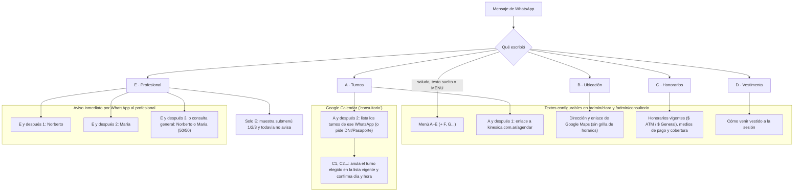
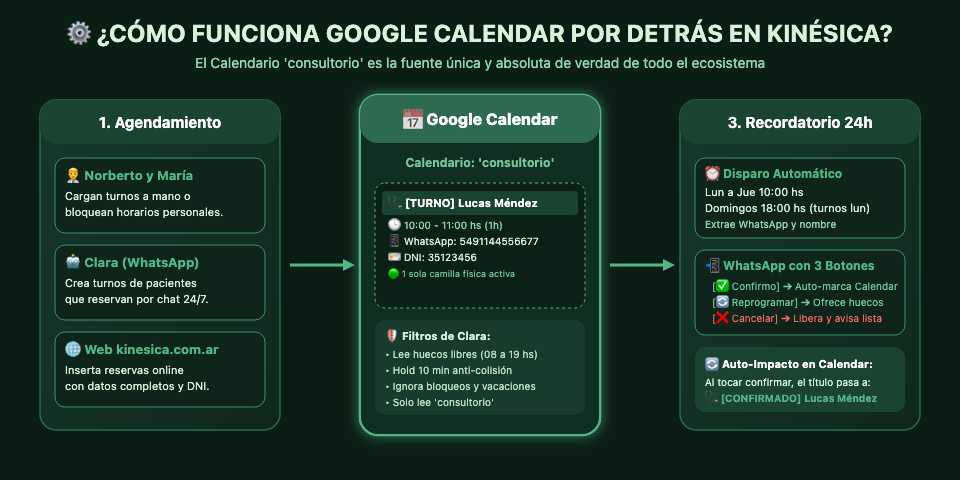
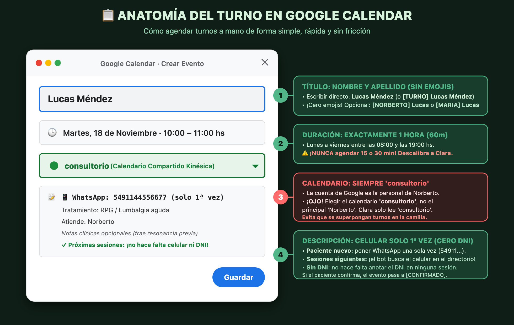
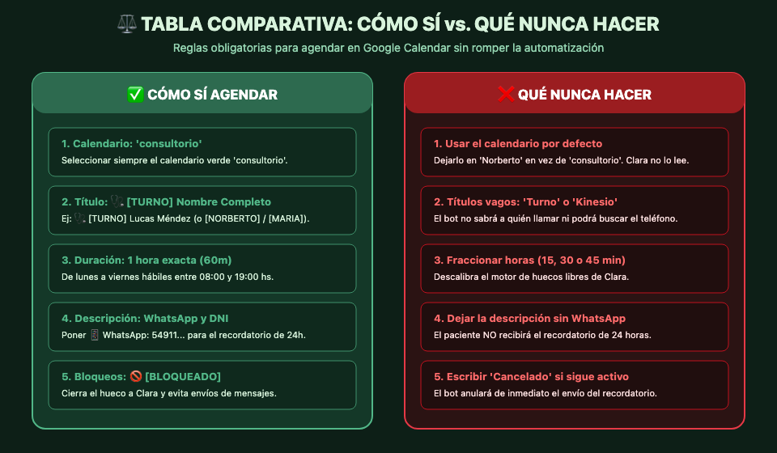
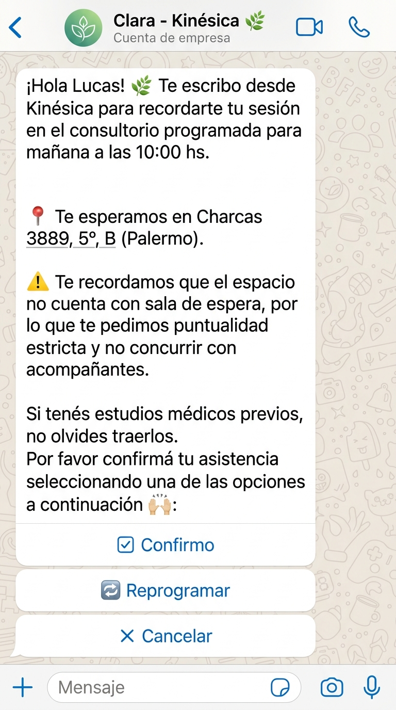
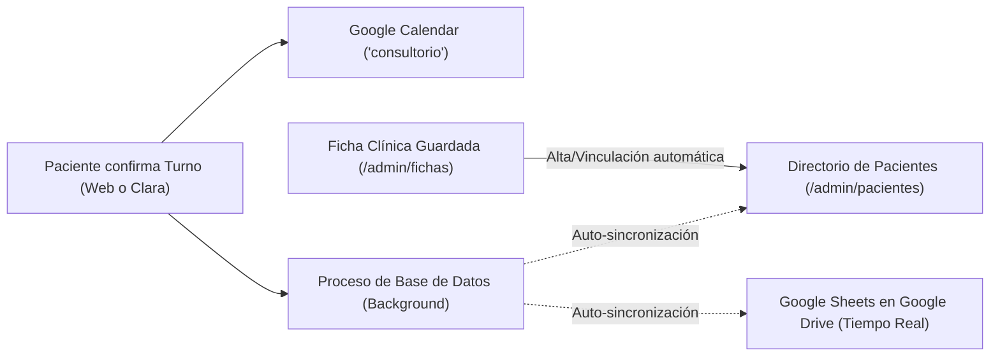

# 🌿 Manual de Clara: La Asistente y Secretaria Virtual de Kinésica
### Guía práctica y operativa del consultorio

> **¿Qué es este documento?**  
> Una explicación simple y clara de cómo funciona **Clara**, cómo atiende a los pacientes que escriben al WhatsApp del consultorio, cómo se sincroniza con **Google Calendar (`consultorio`)** y con el **Panel de Administración (`/admin/`)**, y cómo los profesionales del equipo pueden gestionarla desde la web o desde su celular.  
> 
> 🔐 **Guía de Acceso y Panel de Profesionales (2FA):** [Ver Guía de Acceso](configuracion-cuentas-profesionales.md)  
> 🧪 **Guía Oficial de Pruebas y Comandos:** [Ver Guía de Pruebas](guia-pruebas.md)  
> 📱 **Cuenta de WhatsApp de Clara:** [Ver Configuración de WhatsApp](cuenta-whatsapp-clara.md)  
> 💾 **Copias de Seguridad y Recuperación (Backups):** [Ver Manual de Backups](backups-y-recuperacion.md)  
> *(Este manual está restringido exclusivamente a usuarios administradores del panel `/admin/`).*

---

## 🧭 ¿Qué buscar y dónde? (guía rápida)

| Si necesitás... | Andá a... |
|---|---|
| Ver / bloquear / cancelar turnos manualmente | **Google Calendar (`consultorio`)** → [Sección 3](#3-guia-maestra-de-google-calendar-como-funciona-por-detras-que-deben-hacer-y-que-no) y [Sección 9](#9-machete-rapido-de-comandos-para-los-profesionales) |
| Cambiar horarios de atención u honorarios ($ ATM / $ General) | **Panel Admin → Consultorio (`/admin/consultorio`)** → [Sección 2.2](#22-horarios-honorarios-y-reglas-de-atencion-del-consultorio) |
| Editar textos del menú de Clara (`A`–`E`, `F`...) o probar en el simulador | **Panel Admin → Clara & Mensajes (`/admin/clara`)** → [Sección 2.1](#21-menu-interactivo-por-letras-a-e-modo-sin-ia-activo-por-defecto) |
| Pausar o reactivar a Clara (o alternar entre Modo Menú y Modo IA) | **Panel Admin (`/admin/`)** o WhatsApp de Norberto/María → [Sección 5](#5-el-modo-administrador-como-le-hablan-los-profesionales-a-clara) |
| Saber qué avisos les llegan a Norberto y María | [Sección 4](#4-que-notificaciones-le-llegan-a-norberto-y-a-maria-a-su-celular) |
| Ver y gestionar pacientes, datos de contacto o pedir reviews de Google | **Panel Admin → Pacientes (`/admin/pacientes`)** → [Sección 7](#7-directorio-de-pacientes-fichas-clinicas-y-resenas-de-google) |
| Cargar historias clínicas de ATM y evaluación craneomandibular | **Panel Admin → Fichas Clínicas (`/admin/fichas`)** → [Sección 7.4](#74-historias-clinicas-de-atm-y-evaluacion-craneomandibular-adminfichas) |
| Supervisar recordatorios de turnos, cargar contactos o enviar manual | **Panel Admin → Recordatorios (`/admin/recordatorios`)** → [Sección 3.3](#33-recordatorio-automatico-de-turnos-en-whatsapp) |
| Auditar mensajes de WhatsApp e historial de conversaciones | **Panel Admin → Interacciones (`/admin/interacciones`)** → [Sección 4.2](#42-auditoria-de-interacciones-en-tiempo-real-admininteracciones) |
| Ver quién espera un hueco liberado | Pestaña `Lista de Espera` en Google Sheets → [Sección 6](#6-lista-de-espera-inteligente-en-google-sheets) |
| Probar a Clara desde el simulador o el celular | [Sección 8](#8-como-probar-a-clara-y-supervisar-el-sistema) y [Guía de Pruebas](guia-pruebas.md) |
| Descargar backups de la base de datos o ver copias de seguridad | **Panel Admin → Menú Administración → Base de Datos y Backups** → [Manual de Backups](backups-y-recuperacion.md) |
| Reportar un error técnico o enviar sugerencias con fotos/videos | **Panel Admin → Menú Administración → Reportar Error** → [Sección 8.3](#83-reporte-y-seguimiento-de-errores-tecnicos) |
| Gestionar usuarios, roles (Admin/Profesional) o gastos | **Panel Admin → Menú Administración** → [Guía de Acceso](configuracion-cuentas-profesionales.md) |

---

## 📑 Índice de Contenidos

1. [**👩‍💼 1. ¿Quién es Clara y cuál es su trabajo?**](#1-quien-es-clara-y-cual-es-su-trabajo)
   - [Sus responsabilidades principales](#sus-responsabilidades-principales)
2. [**🩺 2. ¿Cómo habla y cómo atiende a los pacientes?**](#2-como-habla-y-como-atiende-a-los-pacientes)
   - [🔤 2.1. Menú interactivo por letras A–E (Modo sin IA — Activo por defecto)](#21-menu-interactivo-por-letras-a-e-modo-sin-ia-activo-por-defecto)
     - [⚡ Respuestas Zero-Friction (Prepagas, Agradecimientos y Derivación Directa)](#respuestas-zero-friction-prepagas-agradecimientos-y-derivacion-directa)
   - [🕒 2.2. Horarios, honorarios y reglas de atención del consultorio](#22-horarios-honorarios-y-reglas-de-atencion-del-consultorio)
   - [🤖 2.3. Modo Agente IA conversacional (Opcional — Comando "modo ia")](#23-modo-agente-ia-conversacional-opcional-comando-modo-ia)
   - [🛡️ 2.4. Validador de Calidad en Tiempo Real (Guardrail en Modo IA)](#24-validador-de-calidad-en-tiempo-real-guardrail-en-modo-ia)
3. [**📅 3. Guía Maestra de Google Calendar: Cómo Funciona por Detrás, Qué Deben Hacer y Qué NO**](#3-guia-maestra-de-google-calendar-como-funciona-por-detras-que-deben-hacer-y-que-no)
   - [⚙️ 3.1. ¿Cómo funciona por detrás? (El Cerebro del Sistema)](#31-como-funciona-por-detras-el-cerebro-del-sistema)
   - [🔄 3.1.1. Coherencia Total: Turnera Web (/agendar) vs. WhatsApp con Clara](#311-coherencia-total-turnera-web-agendar-vs-whatsapp-con-clara)
   - [📋 3.2. Protocolo de Agenda: Qué SÍ hacer y Qué NUNCA hacer (Guía Unificada)](#32-protocolo-de-agenda-que-si-hacer-y-que-nunca-hacer-guia-unificada)
   - [📲 3.3. Recordatorio automático de turnos en WhatsApp](#33-recordatorio-automatico-de-turnos-en-whatsapp)
     - [🔘 Botones del recordatorio interactivo: Confirmar y Cancelar](#botones-del-recordatorio-interactivo-confirmar-y-cancelar)
     - [📊 3.3.1. Supervisión, Carga de Contactos y Despacho (`/admin/recordatorios`)](#331-supervision-carga-de-contactos-y-despacho-adminrecordatorios)
4. [**🔔 4. ¿Qué notificaciones le llegan a Norberto y a María a su celular?**](#4-que-notificaciones-le-llegan-a-norberto-y-a-maria-a-su-celular)
   - [📧 4.1. Contingencia por Caída de WhatsApp (Fallback Automático a Correo Electrónico)](#41-contingencia-por-caida-de-whatsapp-fallback-automatico-a-correo-electronico)
   - [📱 4.2. Auditoría de Interacciones en Tiempo Real (`/admin/interacciones`)](#42-auditoria-de-interacciones-en-tiempo-real-admininteracciones)
5. [**👑 5. El "Modo Administrador": ¿Cómo le hablan los profesionales a Clara?**](#5-el-modo-administrador-como-le-hablan-los-profesionales-a-clara)
   - [📋 A. La agenda del día](#a-la-agenda-del-dia)
   - [🚫 B. Bloquear un horario para no atender](#b-bloquear-un-horario-para-no-atender)
   - [🏖️ C. Vacaciones o receso del consultorio](#c-vacaciones-o-receso-del-consultorio)
   - [⏸️ D. Pausar o reanudar a Clara (Desde el Panel Admin o por WhatsApp)](#d-pausar-o-reanudar-a-clara-desde-el-panel-admin-o-por-whatsapp)
     - [🛑 1. Pausa General / Global del Consultorio](#1-pausa-general-global-del-consultorio)
     - [ℹ️ 2. Por qué la Pausa Individual por Paciente está desactivada](#2-por-que-la-pausa-individual-por-paciente-esta-desactivada)
     - [⏳ 3. Despausa automática de seguridad (Timeout de 8 horas)](#3-despausa-automatica-de-seguridad-timeout-de-8-horas)
   - [🔀 E. Cambiar entre Modo Menú (sin IA) y Modo Agente IA](#e-cambiar-entre-modo-menu-sin-ia-y-modo-agente-ia)
   - [❌ F. Anular o cancelar un turno de un paciente](#f-anular-o-cancelar-un-turno-de-un-paciente)
   - [🩺 G. Los kinesiólogos no son pacientes (solicitud de turnos)](#g-los-kinesiologos-no-son-pacientes-solicitud-de-turnos)
6. [**⏳ 6. Lista de Espera Inteligente en Google Sheets**](#6-lista-de-espera-inteligente-en-google-sheets)
7. [**📊 7. Directorio de Pacientes, Fichas Clínicas y Reseñas de Google**](#7-directorio-de-pacientes-fichas-clinicas-y-reseñas-de-google)
   - [🔄 7.1. Sincronización Automática e Inteligente del Directorio (`/admin/pacientes`)](#71-sincronizacion-automatica-e-inteligente-del-directorio-adminpacientes)
   - [⭐ 7.2. Invitaciones a Reseñas de Google (`Pedir review por WhatsApp`)](#72-invitaciones-a-reseñas-de-google-pedir-review-por-whatsapp)
   - [📋 7.3. Columnas de la Planilla de Primeras Sesiones](#73-columnas-de-la-planilla-de-primeras-sesiones)
   - [🩺 7.4. Historias Clínicas de ATM y Evaluación Craneomandibular (`/admin/fichas`)](#74-historias-clinicas-de-atm-y-evaluacion-craneomandibular-adminfichas)
   - [📁 7.5. Acceso al Directorio Web y a Google Sheets](#75-acceso-al-directorio-web-y-a-google-sheets)
8. [**🧪 8. ¿Cómo probar a Clara y Supervisar el Sistema?**](#8-como-probar-a-clara-y-supervisar-el-sistema)
   - [A. Desde el Simulador Interactivo del Panel Admin](#a-desde-el-simulador-interactivo-del-panel-admin)
   - [B. Desde tu celular en WhatsApp (`/restart`)](#b-desde-tu-celular-en-whatsapp-restart)
   - [💾 8.2. Copias de Seguridad y Recuperación de Datos (Backups)](#82-copias-de-seguridad-y-recuperacion-de-datos-backups)
   - [🐛 8.3. Reporte y Seguimiento de Errores Técnicos](#83-reporte-y-seguimiento-de-errores-tecnicos)
   - [🧭 8.4. Barra de Navegación y Accesos Rápidos del Dashboard](#84-barra-de-navegacion-y-accesos-rapidos-del-dashboard)
9. [**📌 9. "Machete" rápido de comandos para los profesionales**](#9-machete-rapido-de-comandos-para-los-profesionales)

---

## 👩‍💼 1. ¿Quién es Clara y cuál es su trabajo?

**Clara** es la secretaria de recepción virtual de **Kinésica** (Palermo, CABA). Está conectada al WhatsApp del consultorio las **24 horas del día, los 7 días de la semana**, y sincronizada en tiempo real con el **Panel de Administración (`/admin/`)** y **Google Calendar (`consultorio`)**.

### Sus responsabilidades principales
1. **Atender al instante:** Da una primera respuesta educada y profesional en segundos (aguardando una breve ventana de 4 segundos para agrupar mensajes seguidos del paciente), evitando que los pacientes queden esperando o se vayan a otro consultorio.
2. **Guiar por Menú Interactivo (`A`–`E`) o Conversación con IA:** Opera por defecto en **Modo Menú sin IA** (guiando con precisión por letras `A` a `E`, submenús de consulta/cancelación de turnos por WhatsApp o DNI y derivación directa a profesionales) y puede conmutarse en cualquier momento a **Modo Agente IA** (donde también transcribe audios de voz y coordina citas conversacionalmente).
3. **Coordinar la agenda:** Trabaja conectada de forma directa a Google Calendar (`consultorio`) y a la turnera web (`kinesica.com.ar/agendar`), respetando estrictamente los horarios vigentes de cada profesional y la restricción de **1 sola camilla física**.
4. **Cuidar el tiempo de los profesionales:** Filtra preguntas repetitivas (dónde queda, horarios, honorarios, prepagas/obras sociales, medios de pago, reintegros, vestimenta) y avisa directamente al celular de **Norberto** o **María** cuando hay un turno nuevo, una cancelación o una solicitud para hablar con un profesional.

---

## 🩺 2. ¿Cómo habla y cómo atiende a los pacientes?

Clara cuenta con dos modos de operación que comparten la misma agenda (`consultorio`) y la configuración en vivo del panel `/admin/`:
* **📋 Modo Menú por letras (`modo menu` — activo por defecto):** Clara responde de forma 100% determinista (sin usar IA) presentando el menú de opciones **`A` a `E`** (más las opciones personalizadas `F`, `G`... que se agreguen en **`/admin/clara`**). Permite ir a la turnera web (`/agendar`), consultar y cancelar turnos propios por teléfono o DNI (`C1`), ver ubicación, honorarios, vestimenta o pedir contacto directo con Norberto o María.
* **🤖 Modo Agente IA (`modo ia` — opcional):** Clara conversa libremente con lenguaje natural como una secretaria médica de Buenos Aires, interpreta audios de voz y ofrece huecos libres en el chat. Norberto o María pueden alternar entre ambos modos enviando `"modo menu"` o `"modo ia"` por WhatsApp.

---

### 🔤 2.1. Menú interactivo por letras A–E (Modo sin IA — Activo por defecto)

En el **Modo Menú** (`modo menu`, activo por defecto en producción), Clara responde de forma instantánea y 100% determinista según la letra o el número exacto elegido por el paciente. Todos los textos del menú (`menu_welcome`, opciones `A` a `E`, submenús y opciones adicionales `F`, `G`...) se pueden editar en tiempo real desde el panel **`/admin/clara`** (**Clara & Mensajes**), que además cuenta con un **Simulador Interactivo de WhatsApp** para probar los cambios al instante.

Escribir *E* solo no avisa a ningún profesional. Un *1* o un *2* sin haber entrado antes en Turnos (*A*) o en Profesional (*E*) vuelve a mostrar el menú principal.

| Qué escribe el paciente | Qué hace Clara |
|---|---|
| Cualquier saludo, consulta suelta o `MENU` | Muestra el menú de bienvenida (*A* a *E*, más las opciones personalizadas *F*, *G*... configuradas en `/admin/clara`). Escribir `MENU` desde cualquier submenú siempre regresa al menú principal. |
| *A* | Abre el submenú de Turnos: pregunta si quiere agendar un nuevo turno (*1*) o consultar/cancelar sus turnos (*2*). |
| *1* después de *A* | Envía el texto configurado (`opt_a_text`) con el enlace directo a la turnera online: `https://kinesica.com.ar/agendar`. |
| *2* después de *A* (o escribir *"mis turnos"*) | Lista los turnos futuros de ese WhatsApp en Google Calendar (`consultorio`), numerados, y cierra el submenú anterior. Si no encuentra turnos con ese teléfono, ofrece buscarlos ingresando el **DNI o Pasaporte**. |
| DNI o Pasaporte tras *A* → *2* | Busca turnos agendados con ese documento (tolerando puntos, guiones, espacios y letras extranjeras), los lista numerados y habilita su cancelación con *C1*, *C2*, etc. |
| *C1* (o *C2*, *C3*...) | Cancela en Google Calendar el turno correspondiente de la lista vigente (válida por 30 minutos), confirma día y hora al paciente y avisa por WhatsApp al profesional a cargo. Si la lista venció, pide volver a consultar los turnos (*A* → *2*). |
| *B* | Envía el texto de ubicación y enlace de Google Maps configurado en `/admin/clara` (`opt_b_text`), tal cual, sin adjuntar la grilla de horarios de los profesionales. |
| *C* | Envía el texto de honorarios y cobertura configurado en `/admin/clara` (`opt_c_text`), reemplazando automáticamente `{honorario_atm}`, `{honorario_general}` y `{medios_pago}` con los valores vigentes de la pestaña **Consultorio** (`/admin/consultorio`). |
| *D* | Envía las pautas de vestimenta para la sesión configuradas en `/admin/clara` (`opt_d_text`). |
| *E* y después *1*, *2*, *3* o un texto | Al elegir *E* muestra el submenú de contacto con un profesional (sin disparar alerta todavía). Al responder *1* avisa a Norberto, con *2* avisa a María, y con *3* (o escribiendo directamente su consulta tras *E*) avisa al profesional correspondiente según especialidad o al azar 50/50. |
| *F*, *G*, ... (opciones adicionales) | Responde el texto informativo configurado en el panel **`/admin/clara`** (pestaña **Clara & Mensajes**). Cierra cualquier submenú previo y vuelve a dejar disponible el menú principal. |
| *1* o *2* sin haber elegido *A* o *E* | Vuelve a mostrar el menú principal. No agenda ni avisa a ningún profesional. |

* **Expiración de submenú:** El submenú activo (*A* o *E*) caduca automáticamente a los **15 minutos** (la lista de turnos para cancelar con `C1` dura **30 minutos**), o antes si la persona elige otra letra o escribe `MENU`.
* **Filtro anti-repetición de 20 segundos:** Si un usuario envía exactamente la misma consulta determinista dos veces seguidas en menos de 20 segundos, el sistema ignora el duplicado para no enviar dos respuestas idénticas.

#### ⚡ Respuestas Zero-Friction (Prepagas, Agradecimientos y Derivación Directa)

Para brindar una experiencia cálida y sin fricciones, Clara incluye respuestas inteligentes que se activan antes de requerir que el paciente navegue todo el menú:

1. **Reconocimiento de Prepagas y Obras Sociales:**  
   Si el paciente consulta directamente por coberturas mencionando entidades como **OSDE, Swiss Medical (SMG), Galeno, Medicus, IOMA, PAMI, Accord Salud, Omint, Sancor Salud**, etc., Clara no lo hace perder tiempo: le informa de inmediato los honorarios vigentes, aclarando amablemente que el consultorio atiende de forma **particular** y que se entrega **factura oficial electrónica** para que pueda gestionar el reintegro en su cobertura.
2. **Agradecimientos afectuosos:**  
   Cuando un paciente responde *"gracias"*, *"muchas gracias"*, *"mil gracias"*, *"genial"* o *"joya"*, Clara no le vuelve a enviar todo el menú desplegable. Responde con calidez humana:  
   > *"¡De nada! Quedo a tu disposición si necesitás algo más 🌿"*
3. **Derivación de Consultas Indistintas y Colegas Médicos:**  
   - Si un paciente escribe pidiendo hablar con *"un kinesiólogo"* o *"el profesional"* sin indicar a quién, Clara deriva la consulta directamente a **Norberto Brude** (`+54 11 6156-4311`).  
   - Si quien escribe se presenta como un colega, médico, odontólogo o derivador, el sistema canaliza la comunicación de forma prioritaria con Norberto.
4. **Identificación de Soporte Técnico:**  
   El sistema reconoce de forma unívoca a **Martín Brude** (`+34 658 44 49 35`) en la sincronización e ingesta de mensajes, garantizando soporte técnico y auditoría sin mezclarlo con pacientes clínicos.

---

### 🕒 2.2. Horarios, honorarios y reglas de atención del consultorio

Tanto el menú de Clara como la turnera web (`/agendar`) y el Modo IA respetan en tiempo real los valores y reglas operativas del consultorio:

* **Honorarios dinámicos (configurables en `/admin/consultorio`, actualmente $65.000 ATM / $75.000 resto):** Clara toma en tiempo real los valores y medios de pago configurados en la pestaña **Consultorio** del panel de administración:
  - **$65.000** para ATM (articulación temporomandibular, bruxismo o dolor de mandíbula).
  - **$75.000** para el resto de las consultas y tratamientos (sesiones habituales de 60 minutos).
* **Obras sociales y prepagas:** Se atiende de forma particular en sesiones individuales de 1 hora completa, entregando factura oficial para tramitar el reintegro correspondiente.
* **Dirección exacta, Google Maps y Transporte Público:** `Charcas 3889, Piso 5º, Dpto B, Palermo, CABA`, enlace de Google Maps ([https://maps.app.goo.gl/urpkh4HYe7dSdjPS9](https://maps.app.goo.gl/urpkh4HYe7dSdjPS9)) y referencias de transporte (a 2 cuadras de Av. Santa Fe, Estación Scalabrini Ortiz del Subte D y Jardín Botánico).
* **Franjas Oficiales de Turnos por Profesional (configurables en `/admin/consultorio`):** Los turnos presenciales se otorgan **exclusivamente dentro de los horarios oficiales de cada profesional de lunes a viernes hábiles de 08:00 a 19:30 hs** (administrables en vivo desde la pestaña **Consultorio** del panel `/admin/`, con validación automática de **1 sola camilla física**):
  - **Lic. María Gulin (configuración actual):**
    - **Lunes:** 09:00 a 17:00 hs (turnos de 09:00 a 16:00 hs inclusive; el último turno finaliza a las 17:00 hs).
    - **Martes:** 09:00 a 16:00 hs (turnos de 09:00 a 15:00 hs inclusive; el último turno finaliza a las 16:00 hs).
    - **Viernes:** 09:00 a 13:00 hs (turnos de 09:00 a 12:00 hs inclusive; el último turno finaliza a las 13:00 hs).
    - **Miércoles y Jueves:** No atiende en consultorio.
  - **Lic. Norberto Brude (configuración actual):**
    - **Lunes:** 17:30 a 19:30 hs (turnos de 17:30 a 18:30 hs inclusive; el último turno finaliza a las 19:30 hs).
    - **Martes:** 16:30 a 19:30 hs (turnos de 16:30 a 18:30 hs inclusive; el último turno finaliza a las 19:30 hs).
    - **Miércoles:** 09:00 a 16:30 hs (turnos de 09:00 a 15:30 hs inclusive; el último turno finaliza a las 16:30 hs).
    - **Jueves:** 15:00 a 19:00 hs (turnos de 15:00 a 18:00 hs inclusive; el último turno finaliza a las 19:00 hs).
    - **Viernes:** 13:30 a 19:30 hs (turnos de 13:30 a 18:30 hs inclusive; el último turno finaliza a las 19:30 hs).
  - **Regla Estricta de Duración y Finalización:** *"Si dice de 9 a 13 es que se puede dar turnos de 9 a 12 inclusive"*. Todas las sesiones presenciales duran exactamente 60 minutos (1 hora) y deben finalizar dentro del horario de atención del profesional. No se otorgan turnos en sábados, domingos ni feriados nacionales.
  - **Ventana Máxima de Agendamiento (Máximo 60 Días):** Los turnos pueden reservarse hasta un **máximo de 60 días corridos a futuro**.
* **Capacidad física (1 sola camilla):** El consultorio cuenta con **una única camilla física de atención**. La atención es 100% individual y secuencial; nunca pueden superponerse dos turnos en el mismo horario.
* **Condiciones del espacio y puntualidad:**
  - **Sin sala de espera:** El consultorio no cuenta con sala de espera.
  - **Sin acompañantes:** Se solicita asistir solos (salvo menores de edad, que deben concurrir con un adulto responsable, o pacientes que requieran asistencia directa para movilizarse).
  - **Puntualidad estricta:** Nunca se pide llegar con 10 o 15 minutos de anticipación para evitar esperas en la entrada.
* **Indumentaria para la sesión:**
  - Ropa interior o pantalón corto para los varones.
  - Ropa interior con corpiño tradicional (no deportivo), malla de 2 piezas o calza corta para las mujeres.
  - Si sos menor, vení acompañado/a por un mayor.
* **Recepción y reenvío de archivos adjuntos (fotos y PDFs):** Si un paciente envía fotos de órdenes médicas, estudios, radiografías o comprobantes de transferencia bancaria, Clara acusa recibo al instante y se lo reenvía al profesional asignado (o a Norberto si aún no tiene profesional asignado) con enlace directo al chat del paciente.
* **Trato al paciente únicamente por su nombre de pila y privacidad estricta:** Clara saluda al paciente siempre por su nombre de pila (sin apellido) y jamás revela nombres, teléfonos ni horarios de otros pacientes.

---

### 🤖 2.3. Modo Agente IA conversacional (Opcional — Comando "modo ia")

Cuando Norberto o María activan el **Modo IA** enviando `"modo ia"` por WhatsApp, Clara responde con lenguaje natural y aplica las siguientes reglas clínicas adicionales:

* **Escucha activa y empatía ante el dolor:** Se presenta por única vez (*"Hola [Nombre], buen día. Soy Clara de Kinésica 🌿"*), valida con calidez el motivo de consulta del paciente y propone coordinar la sesión de 1 hora.
* **Regla de honorarios al pedir turno sin aclarar ATM:** Si el paciente pide turno sin mencionar ATM, bruxismo o mandíbula, Clara informa **únicamente el valor de las sesiones habituales ($75.000)**.
* **Mapeo estricto por disciplina:**
  - **Osteopatía y Manipulaciones viscerales (Barral):** Norberto Brude.
  - **Acupuntura y Posturología:** María Gulin.
  - **Reeducación Postural Global (RPG) y Neurodinamia:** cualquiera de los dos profesionales.
  - **Kinesiología Respiratoria:** no se realiza (se informa con calidez).
  - **Kinesiología Domiciliaria:** se deriva directamente a Norberto (`[DERIVAR_A_NORBERTO]`).
  - **Consultas por masajes:** se entienden y responden siempre hablando de **sesiones** de 1 hora (nunca de "masajes").
  - **Preferencia por kinesióloga mujer:** asigna y notifica directamente a la Lic. María Gulin (`11 2853-1224`).
* **Proactividad de agenda y retención temporal de 10 minutos (`slotHolds`):** Propone 2 horarios libres concretos respetando el día/franja pedidos (con margen mínimo de 90–120 min si es para hoy) y retiene temporalmente esos horarios por **10 minutos** para evitar colisiones entre dos pacientes simultáneos.
* **Pacientes habituales vs. nuevos:** A quien ya tuvo al menos un turno (`sessionsCount >= 1`) no se le vuelve a pedir nombre ni DNI; si no consta en su ficha con qué profesional se atiende, Clara se lo consulta antes de ofrecer horarios. A los pacientes nuevos les solicita **Nombre completo** y **DNI** (el DNI es flexible y opcional: si el paciente prefiere no darlo, se agenda igual registrando `🪪 DNI: No provisto`).

### 🛡️ 2.4. Validador de Calidad en Tiempo Real (Guardrail en Modo IA)

Cuando Clara opera en **Modo IA (`modo ia`)**, antes de enviar cada respuesta al paciente, un **segundo modelo auditor (Guardrail Clínico)** junto con guardas deterministas de código verifica en milisegundos que:
1. Se informen exactamente los honorarios oficiales vigentes (`$65.000` ATM / `$75.000` general).
2. No se pida llegar minutos antes de la sesión y se recuerden las condiciones del espacio (sin sala de espera ni acompañantes).
3. Se respete la privacidad total de terceros y el trato exclusivo por nombre de pila (sin apellidos).
4. No existan superposiciones de agenda en Google Calendar ni turnos fuera del horario del profesional o a más de 60 días.
5. Se cumpla el mapeo por disciplina y que ningún turno se confirme sin contar con el Nombre Completo del paciente.

---

## 📅 3. Guía Maestra de Google Calendar: Cómo Funciona por Detrás, Qué Deben Hacer y Qué NO

> 🎯 **Objetivo de esta sección:**  
> Esta es la guía operativa indispensable para **Norberto, María y cualquier persona que administre la agenda de Kinésica**. Explica con ilustraciones y diagramas exactamente cómo funciona el motor del bot detrás de escena, qué deben hacer al cargar o modificar turnos a mano, y cuáles son los errores que jamás deben cometerse para asegurar que ningún paciente quede sin recordatorio y evitar superposiciones de camilla.

> [!IMPORTANT]
> **La cuenta de Google del consultorio es la cuenta personal de Norberto (`norberto1712@gmail.com`):**  
> No existe una cuenta de Google separada para Kinésica ni tienen que cambiar de usuario en el celular o la computadora. Norberto usa su cuenta personal de siempre (y María accede al calendario compartido desde su propia cuenta).  
> **La clave operativa está dentro de Google Calendar:**  
> En la cuenta de Norberto conviven su calendario principal por defecto (titulado `"Norberto Brude"` o `"Eventos"`) y el calendario del consultorio (**`consultorio`**, con color verde).  
> **Clara, la turnera web y el bot de recordatorios están conectados única y exclusivamente al calendario `consultorio`**.

---

### ⚙️ 3.1. ¿Cómo funciona por detrás? (El Cerebro del Sistema)

Clara y el bot de recordatorios operan conectados directamente al calendario compartido **`consultorio`** en Google Calendar:

  
   
  <em>Figura 1: Arquitectura y sincronización entre Google Calendar, Clara y el bot de recordatorios.</em>

El flujo técnico detrás de escena se basa en cinco pilares automatizados:

1. 🏛️ **El Calendario `consultorio` como Fuente Única de Verdad (*Single Source of Truth*):**  
   Clara, la turnera web (`/agendar`) y el sistema de recordatorios no almacenan una agenda paralela: en cada consulta leen en tiempo real la API de Google Calendar sobre el calendario `consultorio`. Lo que figura en ese calendario determina con precisión matemática la disponibilidad del consultorio.
2. 🛏️ **Principio de Camilla Única Física y Motor de Huecos Libres (*Free-Slot Engine*):**  
   Kinésica cuenta con **una única camilla física de atención**. La atención es 100% individual y secuencial. El motor solo ofrece huecos de **1 hora completa** de lunes a viernes hábiles dentro de los horarios configurados en `/admin/consultorio`. Cualquier evento existente en el calendario bloquea la totalidad del intervalo para proteger la camilla de colisiones.
3. ⏳ **Hold Temporal Anti-Colisión (10 minutos):**  
   Cuando se ofrecen horarios en el chat, el sistema genera una retención interna de **10 minutos** sobre esos huecos para que dos pacientes simultáneos no reserven el mismo turno.
4. ⏰ **Motor de Recordatorios Automáticos de Turnos (Cron n8n):**  
   Se dispara automáticamente en dos momentos estratégicos para cuidar el descanso de los pacientes:
   - **Domingos a las 18:00 hs:** Busca los turnos del lunes siguiente.
   - **Lunes a Jueves a las 10:00 hs:** Busca los turnos del día hábil posterior (martes a viernes).
   - *(Los viernes y sábados no se despachan recordatorios porque el consultorio no atiende fines de semana).*  
   Al ejecutarse:
   - **Filtra cancelaciones y bloqueos:** Ignora eventos con status cancelado o que contengan en título o descripción palabras como `[CANCELADO]`, `[ANULADO]`, `[SUSPENDIDO]`, `[BAJA]`, `[BLOQUEADO]`, `feriado`, `vacaciones`, la convención **`no dar` / `no dar turno`**, o el código de bloqueo **`Tk3`** (el sistema identifica de inmediato que son bloqueos de camilla, no busca teléfonos en el directorio, los clasifica como omitidos y no despacha ningún mensaje).
   - **Deduplicación Estricta (Máximo 1 por día por persona):** Si un paciente tiene dos eventos o sesiones el mismo día, el sistema le despacha **únicamente 1 recordatorio diario**, deduplicando exclusivamente sobre recordatorios confirmados y efectivamente enviados.
   - **Bloqueo Preventivo de Pasados:** No se procesan ni envían recordatorios de citas con horarios ya transcurridos.
   - **Extrae el nombre de pila:** Clara limpia etiquetas y apellidos para saludar con empatía y cercanía (*"¡Hola Lucas! 🌿"* en vez del frío *"Hola Lucas Méndez"*).
   - **Resuelve el número de WhatsApp:** Primero busca el teléfono en la **descripción** o título del evento (`📱 WhatsApp: 54911...`). Si no figura en el evento, recurre al **Directorio Dinámico de Pacientes** de Kinésica. Si no tiene WhatsApp pero cuenta con correo electrónico, activa la contingencia por Email. Si no tiene ninguno de los dos, el turno aparece en `/admin/recordatorios` con alerta de contacto faltante para que el equipo pueda completarlo a tiempo.
5. 🔄 **Actualización e Impacto Bidireccional en Tiempo Real:**  
   - Si el paciente toca **`[✅ Confirmo]`** en WhatsApp, el bot acusa recibo y edita automáticamente el evento en Google Calendar anteponiendo `[CONFIRMADO]` al título (ej: `🩺 [CONFIRMADO] Lucas Méndez`).
   - Si el paciente toca **`[❌ Cancelar]`**, el sistema anula directamente ese turno (verificando que el botón corresponda al teléfono del paciente) en Google Calendar, le avisa al profesional a cargo (Norberto o María) y comprueba si hay pacientes en la **Lista de Espera Inteligente** (registrada en la hoja de Google Sheets) para ofrecerles el hueco liberado.

---

### 🔄 3.1.1. Coherencia Total: Turnera Web (/agendar) vs. WhatsApp con Clara

En Kinésica existen dos vías automatizadas para que un paciente gestione su turno sin intervención manual:
1. **La Turnera Web Oficial (`kinesica.com.ar/agendar`):** Enviada por Clara en el Menú (`A` → `1`) y disponible desde los botones **"Agendar turno"** del sitio web.
2. **El Chatbot de WhatsApp (Clara):** Permite consultar y cancelar turnos por teléfono o DNI (`A` → `2` y `C1`) en Modo Menú, o coordinar citas conversacionalmente las 24 horas en Modo IA.

**Ambos canales operan de manera 100% coordinada y coherente:**

| Dimensión Operativa | Reserva vía Turnera Web (`/agendar`) | Gestión vía WhatsApp (Clara) | Resultado Unificado |
|---|---|---|---|
| **Calendario de destino** | Google Calendar (`consultorio`) | Google Calendar (`consultorio`) | 🏛️ Fuente única de verdad compartida. |
| **Título del evento (Summary)** | `🩺 [PROFESIONAL] [TURNO] Nombre` (o `[TURNO - MENOR]`) | `🩺 [TURNO] Nombre` (o `[TURNO - MENOR]`) | 🏷️ Reconocimiento unívoco de turnos válidos de 1h. |
| **Duración y ventana** | Exactamente 60 minutos dentro del horario del kinesiólogo | Exactamente 60 minutos dentro del horario del kinesiólogo | ⏱️ Camilla protegida de colisiones y sobreturnos. |
| **Datos en la descripción** | `📱 WhatsApp`, `🪪 DNI`, `Motivo`, `Técnica` | `📱 WhatsApp`, `🪪 DNI`, `Motivo` | 📋 Toda la información de contacto accesible en el evento. |
| **Planilla Google Sheets y Directorio** | Se asienta fila automáticamente en tiempo real | Se asienta fila automáticamente en segundo plano | 📊 Base de datos siempre al día sin duplicar datos. |
| **Alertas a Norberto y María** | Dispara WhatsApp inmediato con datos de la reserva web | Dispara alerta interna inmediata de WhatsApp las 24 hs | 🔔 El profesional se entera al instante en su celular. |
| **Recordatorio automático de turnos** | Se envía el día previo con los 2 botones nativos (si Clara está activa) | Se envía el día previo con los 2 botones nativos (si Clara está activa) | 📲 El paciente confirma o cancela con 1 toque. |

---

### 📋 3.2. Protocolo de Agenda: Qué SÍ hacer y Qué NUNCA hacer (Guía Unificada)

Google Calendar (calendario **`consultorio`**) es la **única fuente de verdad** del consultorio. Para que el equipo humano y Clara trabajen en perfecta sincronía sin superposiciones ni fallas de recordatorios, así debe cargarse un turno manual:

  
   
  <em>Figura 2: Ejemplo de turno correctamente cargado en el calendario "consultorio" de Google Calendar.</em>

  
   
  <em>Figura 3: Comparativa rápida de buenas prácticas al cargar o gestionar turnos en Google Calendar.</em>

| Aspecto / Operación | ✅ Qué SÍ hacer | ❌ Qué NUNCA hacer | 💡 Impacto en el Sistema / Clara |
|---|---|---|---|
| **1. Calendario de destino** | Seleccionar siempre el calendario **`consultorio`** (color verde). | Dejar el evento en el calendario personal por defecto (`"Norberto Brude"`). | Clara solo lee `consultorio`. Si queda en el personal, no lo ve, cree que la camilla está libre y agendará a otro paciente en ese horario. |
| **2. Título de la cita (Summary)** | Escribir nombres prolijos: `Lucas Méndez` (o `[TURNO] Lucas Méndez`). • Menor: `Lucas Méndez (Familiar: Andrea Gómez)`. • Profesional opcional: `[NORBERTO]` o `[MARIA]`. *(Sin comas, sin emojis y sin saltos de línea).* | Poner títulos vagos sin nombre: `"Turno"`, `"Paciente"`, `"RPG"`, `"Kinesio"`. | El bot extrae el nombre de pila para saludar con calidez y sincroniza al paciente en formato Title Case en el directorio. |
| **3. Carga del teléfono (WhatsApp)** | **Cargar el celular 1 sola vez por cualquiera de estas 2 vías:** • **Opción A (Planilla o Panel):** Asentar Nombre y Celular en el panel `/admin/pacientes` o [Google Sheets](https://docs.google.com/spreadsheets/d/1kyGkYea0Iu_OrXxF-yONqhs2rG1O8YUWbbSmQe37GCk/edit). • **Opción B (1º turno):** Escribir en la descripción `📱 WhatsApp: 54911...` solo la 1ª vez. *(En las sesiones 2ª en adelante, la descripción puede dejarse vacía).* | • Olvidar anotar el WhatsApp en la 1ª sesión de un paciente nuevo. • Perder tiempo volviendo a escribir el teléfono en cada sesión de pacientes habituales. | El bot memoriza el teléfono en su Directorio Dinámico permanente. Para los turnos siguientes, con solo el nombre en el título, rescata el teléfono automáticamente. |
| **4. DNI / Documento** | No es obligatorio en el día a día. Se registra en la admisión/planilla o cuando el paciente agenda en la web o por chat (si desea aportarlo). | Exigir o cargar el DNI en cada sesión manual en Google Calendar. | El DNI es opcional y solo se solicita una única vez al ingresar al consultorio. No es requisito para despachar recordatorios. |
| **5. Duración y Horarios** | Exactamente **60 minutos** (1 hora), pudiendo iniciar en hora en punto (:00) o y media (:30) según la disponibilidad vigente (ej: 15:30 a 16:30 hs) dentro del rango de atención de 08:00 a 19:30 hs. | • Turnos de duraciones distintas a 60 min (15, 30 o 45 min). • Superponer eventos a la misma hora. | Hay **1 sola camilla física**. Duraciones irregulares descalibran los huecos libres y las superposiciones colapsan la atención presencial. |
| **6. Bloqueos de agenda (almuerzos, trámites, "No dar" o "Tk3")** | Crear evento en el calendario **`consultorio`** con el título `🚫 [BLOQUEADO]`, `[BLOQUEADO]`, **`No dar` / `No dar turno`** o **`Tk3`** en el horario requerido. | • Anotarlo en el calendario personal. • Creer que "No dar" o "Tk3" es un nombre de paciente. • Pedirle a Clara por WhatsApp que bloquee horarios. | Clara reconoce el evento como horario ocupado y no lo ofrece. El sistema de recordatorios sabe que **`No dar` y `Tk3` son bloqueos de turno y no personas**: no busca teléfonos, no los agrega al directorio y no genera falsas alertas. |
| **7. Vacaciones / Receso** | Crear evento de **día completo** en **`consultorio`** titulado `🏖️ [VACACIONES CONSULTORIO - CERRADO]` (o con la palabra `Vacaciones` / `Cerrado`). | Cerrar el consultorio sin marcar el evento de día completo en `consultorio`. | Clara y la turnera web detectan el cierre de día completo y no ofrecen ni confirman turnos en esas fechas. |
| **8. Cancelaciones manuales** | • **Recomendado:** Eliminar el turno directamente en Google Calendar (tacho de basura). El hueco queda liberado al instante. • **Historial:** Si desean conservarlo, anteponer `[CANCELADO]` o `[ANULADO]` al título en Google Calendar. | • Escribir `"Cancelado"` en un turno que sigue activo y en pie. • Pedirle a Clara por WhatsApp que anule turnos de pacientes. | Las cancelaciones de los profesionales se gestionan siempre en Google Calendar. El bot detecta `[CANCELADO]` y anula de inmediato el recordatorio. |
| **9. Uso de Clara por Kinesiólogos** | Recibir alertas internas de turnos y usar comandos de control (`pausar bot`, `reanudar bot`, `olvidar <paciente>`, `modo menu` / `modo ia`). | Pedirle a Clara por WhatsApp que les agende un turno, cree bloqueos o cancele citas de pacientes por chat. | Clara reconoce sus celulares como administradores. Los turnos, bloqueos y cancelaciones de citas se gestionan en Google Calendar. |

---

### 📲 3.3. Recordatorio automático de turnos en WhatsApp

Cuando un turno se agenda correctamente en Google Calendar y Clara está activa en el backoffice, el bot de recordatorios se activa a las 10:00 hs (o domingos a las 18:00 hs para turnos de lunes) y despacha automáticamente una plantilla interactiva oficial de WhatsApp:

  
   
  <em>Figura 4: Mensaje oficial interactivo de WhatsApp recibido por el paciente con los botones de confirmación y cancelación.</em>

#### 🔘 Botones del recordatorio interactivo: Confirmar y Cancelar
1. **`[✅ Confirmo]`**:  
   El paciente confirma su presencia con un solo toque. El sistema actualiza Google Calendar al instante cambiando el título a **`🩺 [CONFIRMADO] Nombre Paciente`**, permitiendo que Norberto y María vean de un vistazo en la agenda quiénes ya confirmaron para el día.
2. **`[❌ Cancelar]`**:  
   El paciente avisa que no puede asistir. El sistema anula o elimina el evento en Google Calendar liberando la camilla, le envía una notificación inmediata al profesional a cargo (Norberto o María) y revisa si hay alguien en la **Lista de Espera** (en Google Sheets) para avisarle del lugar disponible.

#### 📊 3.3.1. Supervisión, Carga de Contactos y Despacho (`/admin/recordatorios`)

El consultorio cuenta con un panel especializado de supervisión en **[https://www.kinesica.com.ar/admin/recordatorios](https://www.kinesica.com.ar/admin/recordatorios)** que permite auditar en vivo el estado de todos los recordatorios:

1. **Previsión "A enviar" y Detección Temprana de Contactos Faltantes:**  
   Muestra todos los turnos agendados para la próxima jornada de atención (mañana, o lunes si es fin de semana). Si a algún paciente le falta el teléfono registrado en el evento o en el directorio:
   - El sistema lo resalta claramente con una advertencia visual (*"Sin teléfono"*).
   - Incluye el botón directo **`＋ Cargar contacto`** para ingresar el WhatsApp y/o el correo electrónico del paciente directamente en el directorio sin forzar el envío en ese momento.
2. **Tarjetas de Contacto Interactivas y Limpias:**  
   Cada tarjeta de turno renderiza botones de enlace directos y compactos:
   - **`WhatsApp`:** Abre al instante el chat oficial de WhatsApp Web o de la app móvil con el paciente (`wa.me/...`).
   - **`Email`:** Abre un mensaje de correo electrónico directo dirigido al paciente (`mailto:...`).
3. **Acciones de Despacho Inmediato:**  
   - **`⚡ Enviar ahora`:** Disponible para cualquier turno en estado pendiente que cuente con contacto cargado (incluso en omitidos si se desea forzar el envío).
   - **`⚡ Disparar manualmente`:** Disponible para reintentar el despacho en turnos que hayan fallado por problemas de conectividad o formato de línea.
   - Ambas acciones muestran una ventana modal de confirmación antes de disparar el envío.
   - **Bloqueo preventivo de turnos pasados:** El sistema impide disparar recordatorios de turnos que ya expiraron o corresponden a horarios previos.
4. **Historial de "Enviados":**  
   Registra la confirmación de entrega en tiempo real, detallando si se despachó por la API oficial de WhatsApp o si se activó la contingencia automática por correo electrónico ante falta de línea.
5. **Pestañas "Fallidos" y "Omitidos":**  
   - **Fallidos:** Turnos donde no pudo entregarse el mensaje por problemas en el número o línea.  
   - **Omitidos:** Registros que el sistema descartó intencionalmente por ser bloqueos operativos (`No dar`, `Tk3`, `[BLOQUEADO]`, `vacaciones`) o citas canceladas.

---

## 🔔 4. ¿Qué notificaciones le llegan a Norberto y a María a su celular?

Para no llenarle el WhatsApp de mensajes innecesarios, **Clara no avisa cuando un paciente solo hace preguntas informativas**.

**Solo envía una alerta automática cuando hay algo importante que requiere atención:**

1. 📌 **Nuevo turno confirmado:**  
   Envía una alerta inmediata al profesional con quien se agendó la cita (Norberto o María):
   > *📌 NUEVO TURNO EN KINÉSICA*  
   > • *Paciente:* Lucas Méndez  
   > • *WhatsApp:* wa.me/54911...  
   > • *Mensaje:* "Quería un turno para este jueves a las 16 hs"  
   > • *Respuesta de Clara:* "Te esperamos este jueves a las 16:00 hs..."
2. 🚨 **Cancelación de turno / Cancelación urgente del mismo día:**  
   Si un paciente cancela su turno (desde el botón `[❌ Cancelar]` del recordatorio, con `C1` en el menú o por chat), Clara dispara una alerta al profesional correspondiente avisando que **se liberó ese hueco** e indica si hay alguien en la lista de espera (en Google Sheets) disponible para ocuparlo.
3. ⚠️ **Consultas profesionales y derivaciones (Especialidades de Norberto, María o Azar 50/50 si ambos pueden responder):**  
   - **Especialidades de Norberto (Osteopatía, Manipulaciones viscerales / Barral), pedidos directos (opción `E` → `1`), colegas médicos o consultas de contacto indistinto:** Clara informa al paciente que Norberto Brude se contactará a la brevedad y despacha la alerta directamente a **Norberto (`+54 11 6156-4311`)**.
   - **Especialidades de María (Acupuntura, Posturología) o pedido directo de María (opción `E` → `2`):** Clara informa al paciente que la Lic. María Gulin se contactará a la brevedad y despacha la alerta directamente a **María (`11 2853-1224`)**.
   - **Disciplinas compartidas (RPG / Reeducación Postural Global, Neurodinamia) o consultas generales donde ambos pueden responder (opción `E` → `3`, "con un profesional", "con Norberto o María"):** Ambos profesionales pueden responder, por lo que el sistema **elige al azar entre ellos dos (50/50)** y despacha **exactamente 1 alerta** al profesional seleccionado al azar para su contacto directo, evitando saturar a ambos profesionales.
   - **Solicitud de profesional mujer o kinesióloga mujer:** Clara confirma la disponibilidad de la Lic. María Gulin, ofrece sus horarios o coordina la cita y notifica directamente a **María (`11 2853-1224`)**.
   - **Solicitud de atención a domicilio:** Se informa y alerta directamente a **Norberto (`+54 11 6156-4311`)** para que continúe él personalmente la comunicación.
4. 📎 **Archivos adjuntos (estudios médicos, órdenes o comprobantes):**  
   Cuando un paciente manda una foto o PDF, Clara acusa recibo y le envía al profesional asignado (o a Norberto si no tiene profesional definido) una alerta inmediata con el nombre, mensaje, tipo de archivo y el enlace directo `wa.me/...` para abrir el chat del paciente y ver o descargar el original con un solo toque.
5. 🌐 **Nueva reserva realizada desde la turnera web (`/agendar`):**  
   Cuando un paciente agenda directamente a través de la turnera online ([`kinesica.com.ar/agendar`](https://www.kinesica.com.ar/agendar)), el sistema crea el evento en Google Calendar y le envía automáticamente al profesional seleccionado (Norberto o María) una alerta por WhatsApp con el tipo de cita (Turno 1h), datos del paciente, DNI, motivo y notas.
   - **Compatibilidad total con Clara:** Los eventos creados en la web (con formato `🩺 [NORBERTO] [TURNO] Nombre`, `🩺 [MARIA] [TURNO] Nombre` o `🩺 [TURNO - MENOR] Nombre (Familiar: Tutor)`) son reconocidos de forma nativa por Clara.
   - **Directorio Dinámico de Pacientes:** El número de WhatsApp del paciente se indexa automáticamente en el directorio de Kinésica. Si en el futuro Norberto o María agendan a ese paciente escribiendo solo su nombre sin teléfono en Google Calendar, el bot de recordatorios resuelve el teléfono desde el directorio y le despacha el recordatorio con su nombre de pila.
   - **Acompañamiento de menores:** Si el turno proviene de la web con indicación de menor y familiar, el recordatorio agrega automáticamente la indicación de concurrir acompañado por un adulto responsable.

*(En todos los avisos, Norberto y María pueden presionar directamente el enlace azul `wa.me/...` para escribirle o llamarlo al paciente desde su propio WhatsApp con un solo toque. Clara permanece activa en su línea para seguir respondiendo si el paciente vuelve a usar el menú o hace otra consulta).*

### 📧 4.1. Contingencia por Caída de WhatsApp (Fallback Automático a Correo Electrónico)
Si por algún motivo el servicio de Meta WhatsApp se interrumpe, se cae o falla al entregar un mensaje, Clara activa automáticamente un **circuito de respaldo por correo electrónico**:
* **Destinatario oficial:** `norberto1712@gmail.com`
* **Cuándo se activa:**
  1. Si falla el envío de cualquier alerta operativa al profesional (turnos nuevos, cancelaciones, archivos adjuntos, derivaciones).
  2. Si WhatsApp cae y no se pudo entregar la respuesta de Clara al paciente (se recibe el nombre del paciente, su WhatsApp y el mensaje para responderle manualmente).
  3. Si ocurre una contingencia técnica en el bot y WhatsApp no puede despachar el aviso.
  4. Si el sistema de recordatorios no puede entregar el recordatorio al paciente por WhatsApp (para que el consultorio sepa que ese paciente no fue notificado).
* **Canal de envío y seguridad:** Despacho nativo vía Google Apps Script (`MailApp`) autenticado con token secreto (`secret`) y destinatario fijo en servidor (`norberto1712@gmail.com`).

### 📱 4.2. Auditoría de Interacciones en Tiempo Real (`/admin/interacciones`)
El consultorio dispone de un registro completo de auditoría en la pestaña **Interacciones** ([`/admin/interacciones`](https://www.kinesica.com.ar/admin/interacciones)):
* **Sincronización en vivo:** Cada mensaje recibido por WhatsApp, respuesta determinista de Clara, audio transcripto o derivación se sincroniza de forma inmediata con la base de datos de producción.
* **Control de respuestas (`answered`):** El sistema preserva el estado de atención para que el equipo sepa qué consultas fueron resueltas por Clara y cuáles requirieron intervención o derivación manual.
* **Búsqueda e historial:** Permite filtrar rápidamente por paciente, número de teléfono o fecha con paginación completa.

---

## 👑 5. El "Modo Administrador": ¿Cómo le hablan los profesionales a Clara?

Clara reconoce automáticamente los celulares del equipo profesional:
* Celular de Norberto: `+54 11 6156-4311`
* Celular de María: `11 2853-1224`

Cuando alguno de los dos le escribe a Clara, ella los saluda por su nombre (*"Hola Norberto..."* o *"Hola María..."*) y se pone a su disposición con comandos directos de administración:

### 📋 A. La agenda del día
Norberto y María la miran en Google Calendar. Clara no arma esa lista por WhatsApp. Si le escriben `"agenda hoy"` o `"¿quién viene?"`, les indica que la vean en el calendario.

### 🚫 B. Bloquear un horario para no atender
Norberto y María marcan ese horario ellos mismos en Google Calendar (`🚫 [BLOQUEADO]`, `[BLOQUEADO]`, **`No dar` / `No dar turno`** o **`Tk3`**). Clara no crea el bloqueo por chat; si se lo piden por WhatsApp, responde: *"Hola [Norberto/María]. Los bloqueos los marcás en Google Calendar."*  
*(El sistema reconoce de forma nativa que `No dar` y `Tk3` son bloqueos de turno y no pacientes: no busca teléfonos en el directorio, los excluye de recordatorios y no genera avisos de contacto faltante).*

### 🏖️ C. Vacaciones o receso del consultorio
* **Cómo cargarlo (recomendado):** Crear un evento de **día completo** en el calendario **`consultorio`** de Google Calendar con el título `🏖️ [VACACIONES CONSULTORIO - CERRADO]` (o que incluya la palabra `Vacaciones` / `Cerrado`) abarcando las fechas del receso.
* **Efecto inmediato:** Tanto Clara como la turnera web (`kinesica.com.ar/agendar`) bloquean automáticamente los días del evento de día completo y sólo ofrecen turnos para fechas posteriores al regreso.

### ⏸️ D. Pausar o reanudar a Clara (Desde el Panel Admin o por WhatsApp)

#### 🛑 1. Pausa General / Global del Consultorio
Silencia a Clara para **todos** los pacientes en simultáneo (útil ante emergencias, mantenimiento o situaciones generales). Se puede activar o desactivar por cualquiera de estas dos vías:

* **Opción A — Desde el Panel de Administración (`/admin/`):**
  - En la pestaña **Inicio** (`/admin/`) o en **Clara & Mensajes** (`/admin/clara`), hacer clic en el botón **"Pausar bot"** (o **"Activar bot"** para reanudarla). El cambio impacta en tiempo real tanto en las respuestas de WhatsApp como en el envío de recordatorios.
* **Opción B — Desde el WhatsApp de Norberto o María:**
  - **Para pausar todo el bot:** Escribirle a Clara `"pausar bot"`, `"silencio"` o `"lo atiendo yo"` (sin especificar paciente). Clara responde *"Entendido [Norberto/María], pausado el bot en general. Te dejo las conversaciones a vos 🙌"* y entra en silencio para todos los pacientes.
  - **Para reanudar todo el bot:** Escribirle `"reanudar bot"`, `"activar bot"`, `"retomar bot"` o `"reanudar todo"`. Clara responde *"¡Listo [Norberto/María]! Vuelvo a estar activa y atenta a las consultas 🌿"*.

#### ℹ️ 2. Por qué la Pausa Individual por Paciente está desactivada
* La **pausa individual por conversación está desactivada por diseño** para garantizar que Clara siempre responda a los pacientes si vuelven a consultar un horario, la dirección o cualquier opción del menú (además, como Norberto y María contactan al paciente desde sus propias líneas tocando el link `wa.me/...`, Clara nunca interfiere en el chat privado entre el profesional y el paciente).
* Si Norberto o María escriben por WhatsApp `"pausar a Lucas"` o `"pausar 11 6123-4567"`, Clara les informa:
  > *"ℹ️ [Norberto/María], la pausa individual está desactivada para que Clara siempre responda las consultas de los pacientes. Si necesitás pausar el bot de forma general, podés usar 'pausar bot' 🙌."*

#### ⏳ 3. Despausa automática de seguridad (Timeout de 8 horas)
Si se pausa el bot por WhatsApp (`"pausar bot"`) y por descuido nadie envía el comando de reanudación, el sistema **levanta automáticamente la pausa tras 8 horas** para garantizar que ningún paciente quede desatendido al día siguiente.

### 🔀 E. Cambiar entre Modo Menú (sin IA) y Modo Agente IA
Desde el WhatsApp de Norberto o María se puede conmutar en vivo el modo de atención de Clara:
* **Activar Modo Menú por letras (por defecto):** Escribir `"modo menu"` o `"modo sin ia"`. Clara confirma: *"📋 Modo activado: Menú Sin IA (Opciones A, B, C...). El bot responderá mediante menú determinista rápido sin usar IA."*
* **Activar Modo Agente IA conversacional:** Escribir `"modo ia"` o `"modo con ia"`. Clara confirma: *"🤖 Modo activado: Agente IA (Clara). Se utilizará el modelo de IA para responder a los pacientes."*

### ❌ F. Anular o cancelar un turno de un paciente
* **Cómo lo hacen Norberto y María:** Las cancelaciones y modificaciones de citas por parte del equipo profesional se realizan **directamente en Google Calendar** (eliminando el turno con el icono del tacho de basura para liberar el hueco al instante, o anteponiendo `[CANCELADO]` si desean conservar el registro histórico).
* **Clara no cancela citas de pacientes a pedido de los profesionales por chat:** Si Norberto o María le piden por WhatsApp a Clara que anule o cancele el turno de un paciente, Clara les recordará que lo gestionen directamente desde Google Calendar para evitar inconsistencias en la grilla y asegurar que el hueco se libere en tiempo real.

### 🩺 G. Los kinesiólogos no son pacientes (solicitud de turnos)
* **Qué pasa si Norberto o María le piden un turno a Clara:** (ej: `"Clara, agendame un turno para mañana a las 15 hs"` o `"quiero un turno"`).
* **Qué hace Clara:** reconoce que son los profesionales, no pacientes. No les pide DNI ni les crea el turno. Si el modelo lo creó, se borra. Les dice:  
  > *"Hola [Norberto/María]. Los turnos son para los pacientes, no para los kinesiólogos de Kinésica."*  
  El horario que no atienden lo marcan ellos en Google Calendar. Clara no lo bloquea por chat.

*(Las acciones que piden Norberto o María no generan auto-alertas molestas).*

---

## ⏳ 6. Lista de Espera Inteligente en Google Sheets

¿Qué pasa cuando un paciente quiere turno para un día o franja que está ocupada o no le sirven las primeras opciones (en Modo IA)?
1. **Regla de precedencia (ofrecer al menos 3 pares de horarios antes de la Lista de Espera):** Clara nunca ofrece la lista de espera de entrada. Primero propone proactivamente **al menos 3 pares de horarios libres (3 tandas de 2 opciones = mínimo 6 horarios ofrecidos)**.
2. Recién si después de haber ofrecido al menos **3 pares de horarios** ninguno le queda cómodo al paciente, Clara le ofrece:  
   *"Si ninguno de estos horarios te queda cómodo, te anoto en nuestra lista de espera y si se libera un hueco te avisamos primero 🙌. ¿Querés que te anote?"*.
3. Si el paciente dice que sí, Clara **NO anota la espera como evento en Google Calendar** (evitando bloquear la camilla o activar por error el bot de recordatorios). En su lugar, registra automáticamente la solicitud en la pestaña **`Lista de Espera`** de la planilla de Google Sheets (guardando fecha, nombre del paciente, WhatsApp, profesional o disciplina solicitada, franja horaria preferida y vencimiento) y notifica al profesional correspondiente.
4. Si más adelante otro paciente cancela su turno de ese día, el sistema detecta la camilla libre, consulta la Lista de Espera vigente y despacha una alerta al profesional a cargo:  
   > *🚨 CANCELACIÓN URGENTE DE HOY EN KINÉSICA*  
   > • *Se liberó un hueco a las 16 hs.*  
   > • 💡 *PACIENTE EN LISTA DE ESPERA DISPONIBLE:* Lucas Méndez (wa.me/54911...).  
   > *¡Podés tocar su enlace para avisarle del lugar liberado!*
5. **Borrado automático por vencimiento:** Si pasa el día o momento solicitado (la hora puntual pedida, las 14:30 hs si pidió por la mañana, o las 19:30 hs si pidió por la tarde/día completo) y no se liberó el turno ni se informó al paciente, el registro **se borra automáticamente** tanto de la memoria operativa como de la pestaña **`Lista de Espera`** en Google Sheets (y también se elimina si el paciente agenda otro turno).

---

## 📊 7. Directorio de Pacientes, Fichas Clínicas y Reseñas de Google

Kinésica mantiene sincronizados los datos de los pacientes tanto en el **Directorio del Panel de Administración (`/admin/pacientes`)** como en las **Fichas Clínicas (`/admin/fichas`)** y la **Planilla de Google Sheets en Google Drive**, mediante procesos automatizados en segundo plano:

### 🔄 7.1. Sincronización Automática e Inteligente del Directorio (`/admin/pacientes`)

El **Directorio de Pacientes** ([`kinesica.com.ar/admin/pacientes`](https://www.kinesica.com.ar/admin/pacientes)) centraliza la información clínica y de contacto con máxima higiene de datos:
1. **Auto-sync desde Historias Clínicas (Fichas ATM):** Al completar y guardar una ficha clínica en `/admin/fichas`, si el paciente no existía en el directorio, el sistema lo crea automáticamente vinculando su historial.
2. **Auto-sync desde Google Calendar / Recordatorios:** Cuando el bot analiza los turnos agendados en Google Calendar, indexa automáticamente a los pacientes reales en el directorio.
3. **Normalización en Title Case y Limpieza Estricta:** Los nombres se guardan prolijamente en mayúsculas y minúsculas (ej: *Juan Carlos Pérez*), eliminando comas, saltos de línea y emojis erróneos.
4. **Exclusión Estricta de Bloqueos:** El sistema descarta eventos como `No dar`, `Tk3`, `Bloqueado` o `Vacaciones`, impidiendo que contaminen la base de pacientes.
5. **Privacidad y Grilla Visual Limpia:** La columna DNI se oculta de la tabla principal para proteger datos sensibles frente a terceros (pudiendo consultarse o editarse al abrir la ficha del paciente). La grilla incluye un botón compacto **`WhatsApp`** que abre directamente el chat con un clic.

### ⭐ 7.2. Invitaciones a Reseñas de Google (`Pedir review por WhatsApp`)

El consultorio cuenta con una herramienta nativa para potenciar la reputación digital en Google Maps:
* En la tabla de **Pacientes** (`/admin/pacientes`), cada paciente que ha asistido a sus sesiones dispone de un botón directo de WhatsApp para invitarlo a calificar el consultorio.
* **Mensaje cálido y personalizado:** Al presionar el botón, se abre WhatsApp con un mensaje pre-armado dirigido a su nombre de pila:
  > *"Hola [Nombre]! 🌿 Esperamos que te hayas sentido muy bien en tus sesiones en Kinésica. Si tenés un minuto, nos ayudaría muchísimo que nos dejes tu opinión en Google: https://g.page/r/.../review ¡Muchas gracias!"*
* **Detección inteligente de reseñas existentes:** El sistema marca visualmente si el paciente ya completó su reseña (por coincidencia de nombre o confirmación manual) para no volver a solicitarla.

### 📋 7.3. Columnas de la Planilla de Primeras Sesiones
1. **Nombre y Apellido:** Nombre completo del paciente o titular.
2. **DNI / Documento:** Número de DNI o documento facilitado (o `No provisto` si el paciente decidió no brindarlo).
3. **Teléfono:** Número de WhatsApp con formato internacional.
4. **Fecha Primera Sesión:** Día y horario acordado para la primera consulta presencial.
5. **Motivo de Consulta:** Motivo clínico indicado al reservar (ej: *ATM / Bruxismo y dolor mandibular*, *Lumbalgia / Ciática*, *RPG / Postura*, *Cervicalgia*, etc.).

### 🩺 7.4. Historias Clínicas de ATM y Evaluación Craneomandibular (`/admin/fichas`)

El módulo clínico de **Historias Clínicas** ([`kinesica.com.ar/admin/fichas`](https://www.kinesica.com.ar/admin/fichas)) está especialmente diseñado para el abordaje de disfunciones temporomandibulares y dolor orofacial (criterios internacionales CDI-TTM):
1. **Formulario Clínico en 6 Pasos:** Anamnesis, hábitos parafuncionales, apertura mandibular activa/pasiva (medición en mm), palpación de músculos masticatorios (maseteros, temporales, pterigoideos), ruidos articulares (clics/crepitaciones) y plan de tratamiento.
2. **Selector de Motivos de Consulta:** Incluye la opción específica **Bruxismo**, además de dolor orofacial, limitación de apertura, chasquidos articulares y cervicalgia asociada.
3. **Evolución y Comparativa:** Permite comparar visualmente la evolución del dolor (escala EVA de 0 a 10) y rangos articulares entre distintas sesiones de un mismo paciente.
4. **Exportación A4 en PDF:** Generación instantánea de informes clínicos profesionales con membrete institucional, firma y sello digital.

### 📁 7.5. Acceso al Directorio Web y a Google Sheets
- **Directorio de Pacientes en el Panel Admin:** [`https://www.kinesica.com.ar/admin/pacientes`](https://www.kinesica.com.ar/admin/pacientes)
- **Fichas Clínicas en el Panel Admin:** [`https://www.kinesica.com.ar/admin/fichas`](https://www.kinesica.com.ar/admin/fichas)
- **Google Sheets en Vivo (Google Drive):** [Abrir Planilla en Google Drive](https://docs.google.com/spreadsheets/d/1kyGkYea0Iu_OrXxF-yONqhs2rG1O8YUWbbSmQe37GCk/edit) (también accesible desde el Dashboard principal de `/admin/`).

---

## 🧪 8. ¿Cómo probar a Clara y Supervisar el Sistema?

### A. Desde el Simulador Interactivo del Panel Admin
1. Ingresá a **[https://www.kinesica.com.ar/admin/clara](https://www.kinesica.com.ar/admin/clara)** (pestaña **Clara & Mensajes**).
2. A la derecha vas a ver el **Simulador de WhatsApp en vivo**, donde podés tocar los botones rápidos (`Hola`, `A`, `B`, `C`, `D`, `E`, `1`, `2`, `MENU`) o escribir cualquier mensaje para probar cómo responde Clara con los textos y honorarios vigentes sin consumir mensajes en tu teléfono.

### B. Desde tu celular en WhatsApp (`/restart`)
1. Abrí el chat de WhatsApp con el número de Clara (`11 3178-1733`).
2. Si escribís desde un teléfono de administrador (Norberto o María) o habilitado para pruebas, escribí:  
   `/restart` *(o desde el teléfono de Norberto/María para reiniciar cualquier otro número: `"olvidar <teléfono o nombre>"`)*
3. **Qué pasará:** Clara borrará la memoria operativa de ese número, su historial, pausas y turnos de prueba en Google Calendar, confirmando:  
   *"🔄 Memoria reiniciada desde cero. Se borraron tu ficha, historial de conversación, pausas, retenciones y turnos futuros de prueba en la agenda. Ya podés escribir tu primer mensaje como paciente nuevo 🙌."*
4. A partir de ahí podés probar como si fueras un paciente que escribe por primera vez.

### 💾 8.2. Copias de Seguridad y Recuperación de Datos (Backups)

El sistema cuenta con una arquitectura de resguardo automatizado de base de datos (`pacientes_kinesica.db`) y archivos de configuración:
* **Copias en Caliente (Hot SQLite Backups):** Permite generar copias de seguridad consistentes sin necesidad de interrumpir el servicio ni suspender la atención de turnos.
* **Descarga Inmediata desde la Web:** Los administradores pueden ingresar al desplegable superior **Administración → Base de Datos y Backups** y descargar un volcado completo de la base de datos con un solo clic.
* **Política de Retención de 8 Semanas:** El servidor rota y mantiene automáticamente las copias semanales de las últimas 8 semanas, depurando copias más antiguas para optimizar almacenamiento.
* 📖 Para conocer el procedimiento de restauración ante contingencias, consultá el [**Manual de Copias de Seguridad y Recuperación ante Desastres**](backups-y-recuperacion.md).

### 🐛 8.3. Reporte y Seguimiento de Errores Técnicos

Para facilitar la comunicación ágil entre el equipo clínico y el soporte técnico de desarrollo:
* **Formulario Dedicado:** Ubicado en la barra superior en **Administración → Reportar Error**.
* **Subida de Evidencias:** Permite describir el comportamiento observado y adjuntar directamente archivos de captura de pantalla y **videos grabados desde la computadora o el teléfono móvil**.
* **Seguimiento Centralizado:** Cada reporte genera un identificador que el equipo técnico audita y resuelve de inmediato.

### 🧭 8.4. Barra de Navegación y Accesos Rápidos del Dashboard

El panel `/admin/` cuenta con una distribución ergonómica optimizada:
* **Dashboard Principal (`/admin/`):** Presenta el saludo del día, estado en vivo de Clara (Activa / Pausada con botón toggle) y accesos directos destacados:
  - **`📖 Manual de Usuario ↗`:** Abre este visualizador interactivo centralizado (`/admin/manual.html`).
  - **`📊 Profesionales para contactar ↗`:** Abre directamente la hoja de cálculo oficial en Google Drive.
* **Operación Médica y Diaria:** Pestañas directas para *Historias Clínicas*, *Pacientes*, *Recordatorios* e *Interacciones*.
* **Configuración del Consultorio y Bot:** Pestañas para *Consultorio* (horarios y honorarios) y *Clara & Mensajes* (textos del menú determinista).
* **Menú Desplegable "Administración":** Menú superior que aísla de forma segura los módulos avanzados: *Usuarios y Cuentas (2FA)*, *Gastos Operativos*, *Base de Datos y Backups* y *Reportar Error*.

---

## 📌 9. "Machete" rápido de comandos para los profesionales

Guardá esta tablita a mano para gestionar a Clara desde el celular de **Norberto** (`11 6156-4311`), de **María** (`11 2853-1224`) o desde el **Panel Admin (`/admin/`)**:

| Qué querés hacer | Cómo hacerlo |
|---|---|
| **Ver la agenda del día** | En **Google Calendar (`consultorio`)**. Clara no lista la agenda por WhatsApp. |
| **Cerrar un hueco específico (bloqueo)** | En **Google Calendar (`consultorio`)** creando un evento `🚫 [BLOQUEADO]`, **`No dar` / `No dar turno`** o **`Tk3`**. Clara no crea bloqueos por chat. |
| **Cerrar por vacaciones o receso** | En **Google Calendar (`consultorio`)** creando un evento de **día completo** `🏖️ [VACACIONES CONSULTORIO - CERRADO]`. |
| **Anular o cancelar el turno de un paciente** | En **Google Calendar (`consultorio`)** eliminando el evento o anteponiendo `[CANCELADO]`. Clara no cancela turnos de pacientes por chat para los profesionales. |
| **Monitorear y gestionar recordatorios** | En el Panel Admin → pestaña **Recordatorios** (`/admin/recordatorios`). Permite ver turnos en "A enviar", cargar teléfonos/emails con `＋ Cargar contacto` y despachar con `⚡ Enviar ahora` o `⚡ Disparar manualmente`. |
| **Auditar conversaciones de WhatsApp** | En el Panel Admin → pestaña **Interacciones** (`/admin/interacciones`). Revisa mensajes de Clara, derivaciones a profesionales (`wa.me`), estado `answered` e historial por paciente. |
| **Pedir reseña de Google a un paciente** | En el Panel Admin → pestaña **Pacientes** (`/admin/pacientes`), tocando el botón de WhatsApp `⭐ Pedir review` en la fila del paciente. |
| **Cargar ficha clínica de ATM** | En el Panel Admin → pestaña **Historias Clínicas** (`/admin/fichas`), con selector de motivo (Bruxismo, ATM, dolor) y exportación a PDF A4. |
| **Cambiar horarios de atención u honorarios ($)** | En el Panel Admin → pestaña **Consultorio** (`/admin/consultorio`). Rango de atención configurable hasta las 19:30 hs. |
| **Editar los textos del menú de Clara (A–E, F...)** | En el Panel Admin → pestaña **Clara & Mensajes** (`/admin/clara`). |
| **Pausar todo el bot (Pausa general)** | Tocando **"Pausar bot"** en `/admin/` o escribiéndole a Clara: `"pausar bot"`, `"lo atiendo yo"` o `"silencio"` (se reanuda solo a las 8 hs si nadie lo reactiva antes). |
| **Reanudar toda la atención de Clara** | Tocando **"Activar bot"** en `/admin/` o escribiéndole a Clara: `"reanudar bot"`, `"activar bot"` o `"reanudar todo"`. |
| **Pausa individual por paciente** | *Desactivada por diseño* para que Clara nunca deje a un paciente sin respuesta. |
| **Cambiar a Modo Menú por letras (sin IA)** | Escribirle a Clara: `"modo menu"` o `"modo sin ia"` *(modo activo por defecto)*. |
| **Cambiar a Modo Agente IA conversacional** | Escribirle a Clara: `"modo ia"` o `"modo con ia"`. |
| **Descargar backup de base de datos** | En el Panel Admin → Menú superior **Administración → Base de Datos y Backups**. |
| **Reportar un error técnico con video/foto** | En el Panel Admin → Menú superior **Administración → Reportar Error**. |
| **Reiniciar tu propio chat de prueba desde cero** | Escribirle a Clara: `/restart` (o `/reset` / `/olvidar`) desde un celular admin o de prueba. |
| **Olvidar / reiniciar la ficha de otro teléfono o paciente** | Escribirle a Clara desde Admin: `"olvidar 11 6123-4567"` o `"olvidar a Lucas"` (también `/restart 11...` o `borrar ficha Lucas`). |

---

*Cualquier sugerencia, ajuste de palabras o cambio en las reglas de atención que se quiera hacer, se puede ajustar en vivo desde `/admin/clara` y `/admin/consultorio`.*
